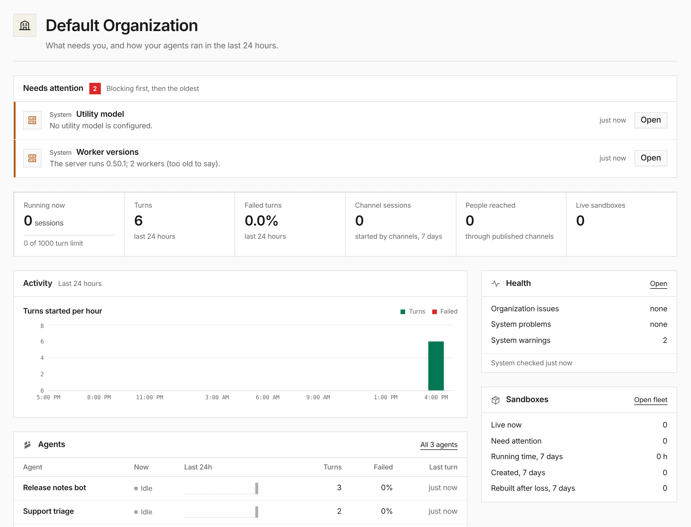

**Home** is a new page above Chat. It starts with **Needs attention**: one
ranked list built from every place that already tracks a problem. That covers
agent setup problems, open health issues such as the active-turn limit, agents
whose recent turns mostly failed, sessions paused at their budget limit,
sandboxes that need attention and failing system checks. Each row links to the
page where you fix it.

Below the list are the last 24 hours: sessions running against the turn limit,
turns and the failure rate, the Monitoring Timeline charts, the busiest agents
and what is running now. Chat stays the page you land on. With the Chat
workspace enabled, signing in opens Chat beside Home.
