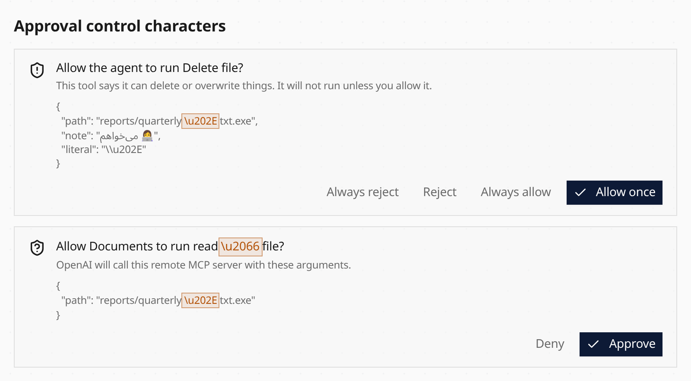

Tool approval cards now reveal hidden directional and control characters before
you decide. For example, a filename containing a right-to-left override shows a
highlighted `\u202E` marker instead of letting that character reorder the preview.
Markers include a code point label for screen readers.

The same display applies to remote MCP approvals and credential consent details.
Persian text, joiners and emoji keep their normal appearance. This changes only
what the card displays: original arguments, saved approval bindings and tool
execution remain unchanged.

