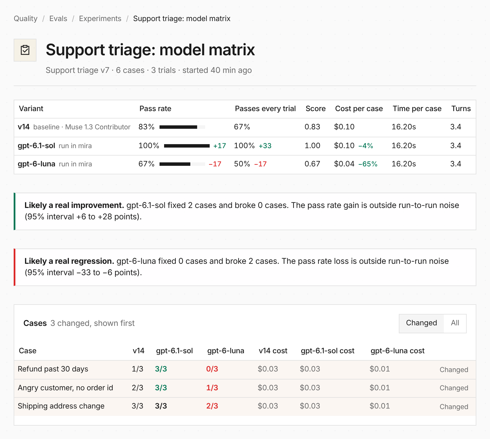

[Mira](https://github.com/everruns/mira), the code-first eval runner, can now
test the agent you deployed rather than a local copy, and put the results where
your team already compares versions. Point its `HostedAgent` subject at one
agent per model:

```rust
let agent = HostedAgent::from_env()? // the agent's URL and agent key
    .route("gpt-6.1-sol", "https://everruns.example/api/v1/channels/chan_sol")
    .route("gpt-6-luna", "https://everruns.example/api/v1/channels/chan_luna");
```

Then run the dataset you exported from Everruns and publish into an experiment:

```bash
everruns evals samples export --eval-id eval_019a4b5c00007000800000000000a001 \
  | jq -c '.samples[]' > cases.jsonl
mira run --study study.rs --publish everruns --everruns-experiment "Support triage: model matrix"
```

Each Mira target becomes one variant, marked as run in Mira, compared case by
case with the agent's current version:



See [Evals](/features/evals/#mira) and Mira's
[hosted agents guide](https://github.com/everruns/mira/blob/main/docs/subjects.md#hosted-agents-hostedagent).
