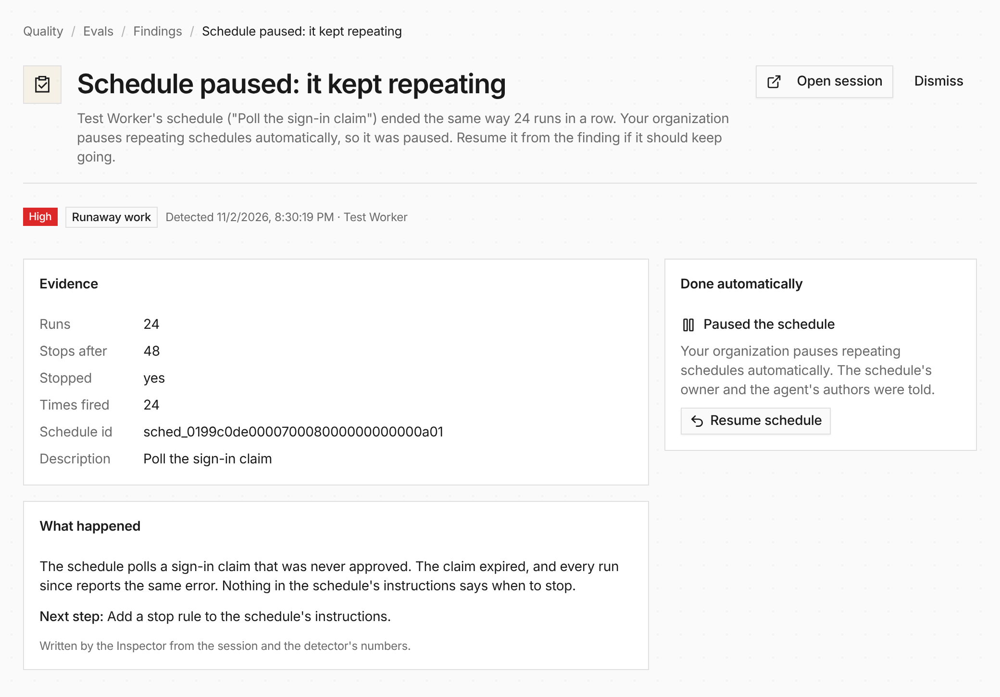

A schedule that polls for something that never changes used to burn 48 runs
before the runaway stop kicked in. Now the [finding](/features/evals/) that
opens at run 24 does something about it: Everruns pauses the schedule, tells
the schedule's owner and the agent's authors, and shows what it did on the
finding page with a **Resume schedule** button. Resuming starts the
repeated-run count over.



Each organization picks how far this goes under **Settings → Limits → When a
finding opens**: pause it, offer to pause it (the finding gets a **Pause
schedule** button instead), or do nothing. The 48-run stop still applies
whatever you pick.

Changes to an agent are never automatic. The Inspector's
[suggested fixes](/changelog/2026-11-02-suggested-fixes/) still wait for
a person to check and approve them, and an organization can turn the
suggestions off.

The same record is in the CLI:

```bash
everruns health-issues actions list --issue-id 0193...
everruns health-issues actions undo --issue-id 0193... --action-id fact_0193... --reason 'Claim still pending'
```
