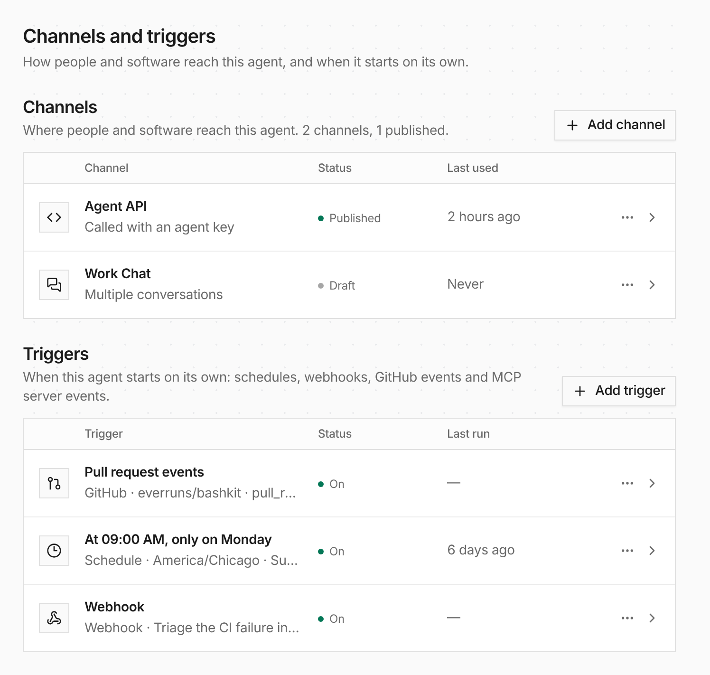

The agent's Integrations tab is now **Channels and triggers**. Channels and
triggers are listed in the same table, and every row opens a page of its own,
so you can link anyone straight to one Slack channel or one schedule.



Webhooks are added as triggers. The agent's GitHub identity moved to its own
page, linked from the Agent tab. The Accept traffic switch became **Pause
agent** in the header menu, and a paused agent also skips its schedules until
you resume it.

API, CLI and MCP results for channels, triggers and GitHub now carry a
`view_url` to that page.

```bash
everruns agents pause agent_01h9 --reason 'Holding traffic during the migration'
everruns agents resume agent_01h9 --reason 'Migration finished'
```

See [Channels](/features/channels/) and [Triggers](/features/agent-triggers/).
