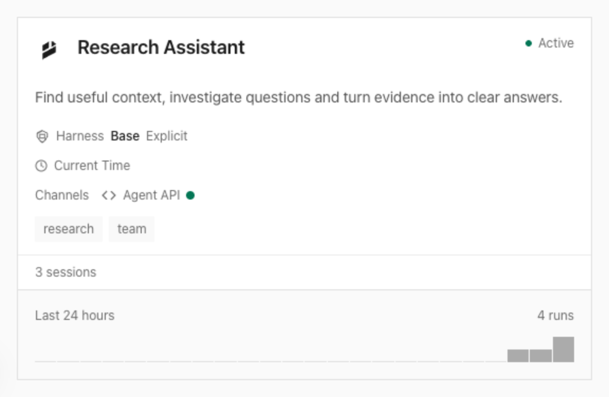

MCP Apps now reuse the Everruns interface: Agent, Harness, Capability and Knowledge
cards, the full organization Home, and Session with Trace, Approvals, Work, Events,
Files and Cost. Agent cards include channels and invocation activity, with links
back to the agent.



Ask your connected client:

```text
Show the Research Assistant agent card, then open its latest session in Trace.
```

The views use your MCP account and organization without a separate browser
sign-in. Read-only credentials keep read-only access. Hosts that support
fullscreen can expand the workspace; other clients retain structured results
and text. See [MCP Apps](/features/mcp/#in-chatgpt-and-codex).
