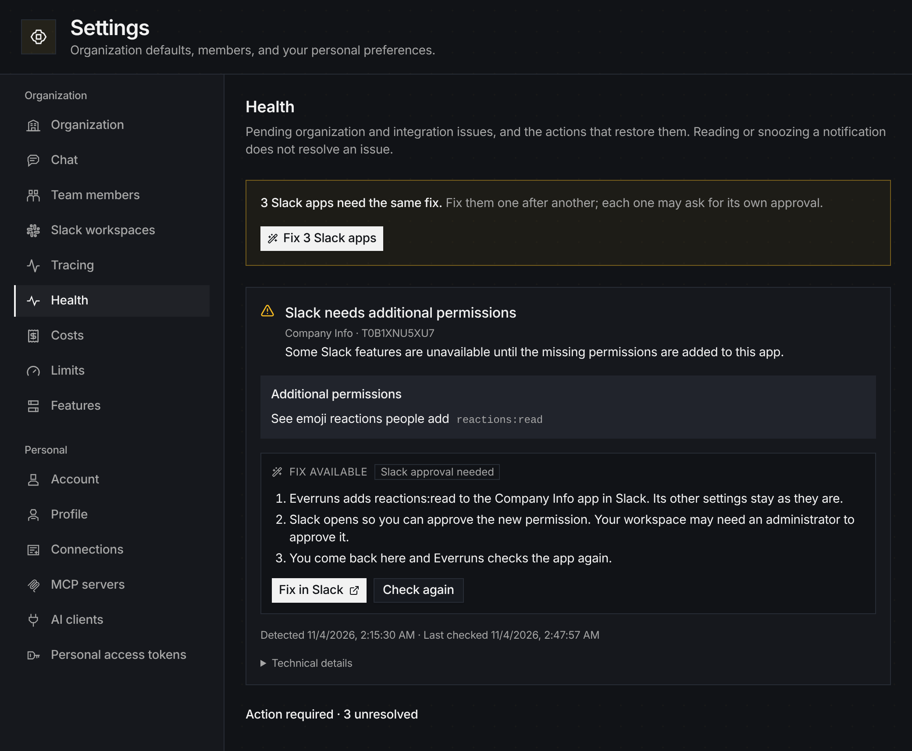

An issue in **Settings → Health** now offers a fix when Everruns can make
the repair itself. When a Slack agent is missing a permission, such as
`reactions:read`, **Fix in Slack** adds it to the app's manifest, keeps the
other settings, and opens Slack to approve the change.



This covers apps you set up by hand too: Everruns finds the app from its bot
token and edits it through your connected Slack workspace. **Fix 3 Slack
apps** walks through several at once. When the fix cannot run yet, the card
links to the step that unblocks it, such as **Reconnect Slack workspace**,
and every Slack app gets manual steps
([Publish to Slack](/how-to/publish-to-slack/#resolve-installation-issues)).

```bash
everruns health-issues fix --issue-id "$ISSUE" --kind slack.add_permissions
```
