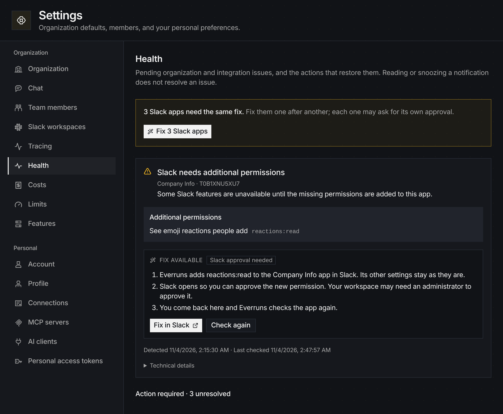

An issue in **Settings → Health** now offers a fix when Everruns can make
the repair itself, not just a list of steps. When a Slack agent is missing a
permission, such as `reactions:read` for emoji reactions, **Fix in Slack**
adds it to the app's manifest, keeps the app's other settings, and opens
Slack to approve the change.



This now covers apps you set up by hand too. Everruns finds the app from its
bot token and edits it through your organization's connected Slack workspace.
Slack then opens the app's install page, and reinstalling keeps the same bot
token. When several apps need the same fix, **Fix 3 Slack apps** walks
through them one at a time. An issue resolves only after Everruns checks the
app with Slack again
([Publish to Slack](/how-to/publish-to-slack/#resolve-installation-issues)).

The same fix runs from the API and CLI:

```bash
everruns health-issues fix --issue-id "$ISSUE" --kind slack.add_permissions
```
