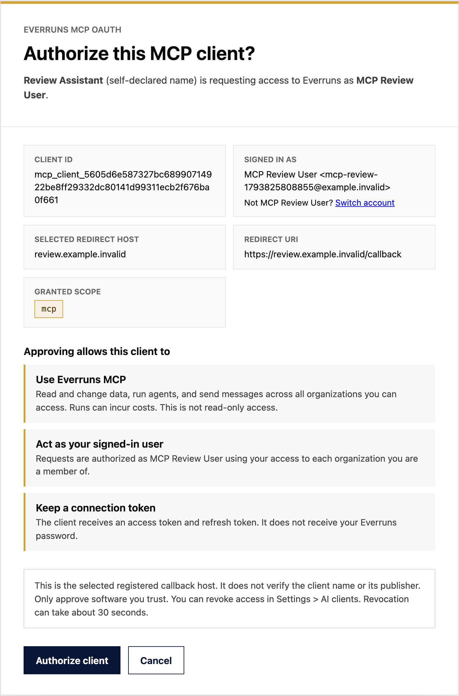

**In the UI:** MCP authorization shows the selected callback host, labels the
client name as self-declared, and explains that the `mcp` scope grants full
access across your organizations. Localhost callbacks do not verify an app's
publisher. Unsupported narrower scopes are rejected.

Session details identify the client that created the session. Message details
and change history identify the client for that individual action, including
when several clients share a session. Older unattributed actions stay unlabeled.

**In code:** sessions expose `mcp_creator`; `input.message` event metadata includes
`mcp_client`. These contain the server-derived client ID, grant ID,
and self-declared registration name. See [MCP client trust and attribution](/features/mcp/).
