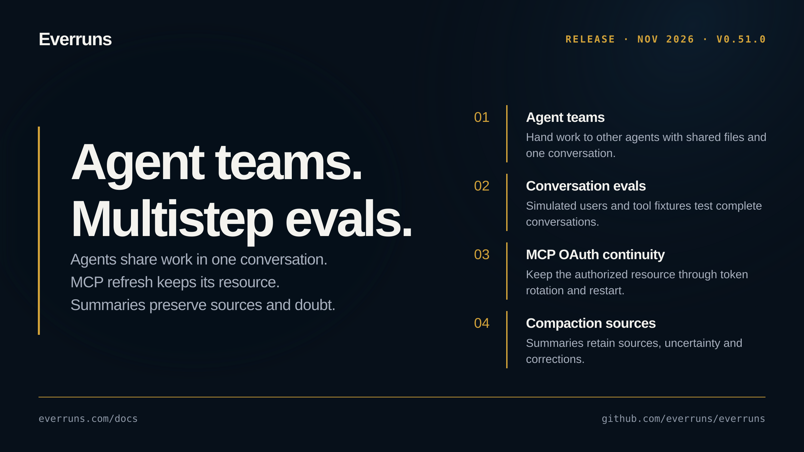

## Highlights

- **Agent teams** - Agents hand work to other agents in one run, share a team folder, and bring questions back to the same conversation ([changelog](https://everruns.com/docs/changelog/2026-11-03-agents-using-agents/), [#5202](https://github.com/everruns/everruns/pull/5202)).
- **Whole-conversation evals** - Simulated users and tool fixtures test complete conversations, with argument checks and selected-case runs ([changelog](https://everruns.com/docs/changelog/2026-11-01-multistep-evals/), [#5160](https://github.com/everruns/everruns/pull/5160)).
- **MCP OAuth resource continuity** - Connections retain the resource selected at sign-in through refresh-token rotation and restart; legacy grants request another sign-in before refreshing ([changelog](https://everruns.com/docs/changelog/2026-11-05-mcp-oauth-resource-continuity/), [#5239](https://github.com/everruns/everruns/pull/5239)).
- **Compaction preserves sources and uncertainty** - Local summarization retains claim sources, unresolved assumptions, user confirmations and corrections across repeated summaries. Provider-native compaction is unchanged ([changelog](https://everruns.com/docs/changelog/2026-11-05-compaction-preserves-sources-and-uncertainty/), [#5240](https://github.com/everruns/everruns/pull/5240)).

## Upgrade notes

- MCP credentials saved before this release need a new sign-in when their access token next needs refresh. An in-progress MCP sign-in must restart after the upgrade. Rolling back to an older server after new credentials have been saved can require reconnecting those MCP connections.
- Rust callers constructing MCP OAuth `TokenSet` values must initialize the new `resource` field; use the resource validated during authorization. An absent resource allows loading older records but cannot authorize refresh.

- Slack duplicate detection now includes the channel identity. A retry of an event first handled before the upgrade can be answered once more after the upgrade.

## In the changelog

- [Exact file edit failures show recovery hints](/changelog/2026-10-31-exact-edit-recovery-hints/)
- [Skill installation preserves cached prompt prefixes](/changelog/2026-10-31-skill-inventory-keeps-prompt-cache/)
- [The person using an Agent approves its tools](/changelog/2026-10-31-tool-approvals-by-caller/)
- [Tool discovery recognizes multilingual words](/changelog/2026-10-31-unicode-tool-discovery/)
- [Scheduled and triggered messages no longer look like yours](/changelog/2026-11-01-automatic-messages-marked/)
- [See what agents cost and limit usage with usage policies](/changelog/2026-11-01-costs-and-usage-policies/)
- [Compare agent variants with eval experiments](/changelog/2026-11-01-eval-experiments/)
- [Emoji reactions on messages, for people and agents](/changelog/2026-11-01-message-reactions/)
- [Monitoring shows parallel sessions and turns over time](/changelog/2026-11-01-monitoring-timeline/)
- [Test whole conversations with simulated users and tool fixtures](/changelog/2026-11-01-multistep-evals/)
- [Long Muse sessions read their history from the prompt cache](/changelog/2026-11-01-muse-long-session-cache/)
- [Home shows what needs attention across the organization](/changelog/2026-11-01-org-home/)
- [Agents can poll a URL without spending model tokens](/changelog/2026-11-01-poll-without-model/)
- [Agent schedules get an end, a budget, a daily cap and health alerts](/changelog/2026-11-01-schedule-limits/)
- [Schedules advance during repeated daylight-saving hours](/changelog/2026-11-01-schedules-advance-through-repeated-hours/)
- [Session Cost tab shows spend by category and over time](/changelog/2026-11-01-session-cost-tab/)
- [Sessions go idle after their turn when workers restart](/changelog/2026-11-01-sessions-idle-after-worker-restarts/)
- [Scheduled runs no longer send the whole session to the model](/changelog/2026-11-01-short-history-scheduled-runs/)
- [Session trace explains failed turns and model calls](/changelog/2026-11-01-trace-error-details/)
- [Trigger and schedule sessions finish work they announced](/changelog/2026-11-01-unattended-turn-completion-check/)
- [Tool approvals reveal hidden bidi controls](/changelog/2026-11-01-visible-approval-control-characters/)
- [Review agents on Bashkit can read the code around a change](/changelog/2026-11-02-bashkit-pull-request-checkout/)
- [Claude message threads send only new messages](/changelog/2026-11-02-claude-message-threads/)
- [The Eval Builder proposes cases for your agents](/changelog/2026-11-02-eval-builder/)
- [The Inspector explains findings and groups similar ones](/changelog/2026-11-02-finding-inspector/)
- [Run a Mira model matrix against your hosted Everruns agents](/changelog/2026-11-02-mira-datasets-experiments/)
- [Observers score conversations and tool calls, and alert on drops](/changelog/2026-11-02-observers-v2/)
- [Scheduled jobs no longer stop when one schedule has no runner](/changelog/2026-11-02-scheduled-jobs-queue-cap/)
- [Repeating schedules now pause themselves, with one-click resume](/changelog/2026-11-02-self-healing/)
- [Suggested fixes for findings, checked by evals](/changelog/2026-11-02-suggested-fixes/)
- [Agents that hand work to other agents](/changelog/2026-11-03-agents-using-agents/)
- [Channels and triggers tab, with Pause agent in the header](/changelog/2026-11-03-channels-and-triggers-tab/)
- [Run a trigger on an event you choose](/changelog/2026-11-03-fire-trigger-with-event/)
- [MCP session status keeps delivered replies visible](/changelog/2026-11-03-mcp-session-reply-snapshot/)
- [MCP Apps open the real Everruns workspaces](/changelog/2026-11-03-mcp-shared-workspaces/)
- [Turns out of provider credits retry smaller or wait for credits](/changelog/2026-11-03-provider-credit-wait/)
- [OpenAI Responses caching defaults to twelve hours](/changelog/2026-11-03-twelve-hour-prompt-cache/)
- [Health and Slack say when an agent's model is unavailable](/changelog/2026-11-04-agent-model-unavailable-alerts/)
- [Run Sandboxes on boxd machines that keep working while idle](/changelog/2026-11-04-boxd-sandboxes/)
- [Gemini usage includes hosted-tool prompt tokens](/changelog/2026-11-04-gemini-tool-use-tokens/)
- [Health issues fix themselves in one click](/changelog/2026-11-04-health-fixers/)
- [Agent turns put less load on PostgreSQL](/changelog/2026-11-04-less-database-work-per-turn/)
- [See which MCP client created a session or message](/changelog/2026-11-04-mcp-consent-client-attribution/)
- [Model refusals stay distinct from provider failures](/changelog/2026-11-04-model-refusals/)
- [Request signing now verifies with Cloudflare Web Bot Auth](/changelog/2026-11-04-web-bot-auth-signing/)
- [Compaction keeps claim sources and uncertainty](/changelog/2026-11-05-compaction-preserves-sources-and-uncertainty/)
- [Agents draw animated GIFs and SVGs with GPT Image 2.6](/changelog/2026-11-05-gpt-image-2-6-gifs/)
- [MCP OAuth keeps its audience when tokens refresh](/changelog/2026-11-05-mcp-oauth-resource-continuity/)

- [Slack agents set to Mentions only answer their @-mentions again](/changelog/2026-11-06-slack-mentions-only/)

[GitHub release](https://github.com/everruns/everruns/releases/tag/v0.51.0) · [Full release notes](https://github.com/everruns/everruns/blob/v0.51.0/CHANGELOG.md#0510---2026-11-05)
