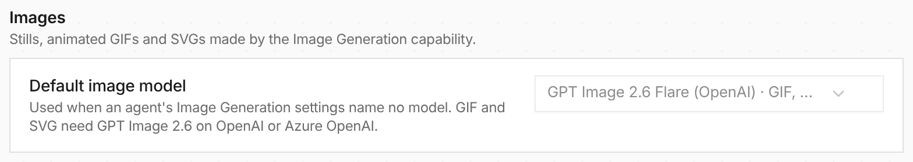

Agents can now make animated GIFs and SVG vector art with
[GPT Image 2.6](https://openai.com/index/introducing-images-2-6/). Ask for a GIF in
chat and the generated image plays above the reply, with its frame count, pause
and download. This lantern was drawn by the Framework example below:

<video src="./chat-gif@2x.mp4" poster="./chat-gif-poster@2x.png" controls muted playsinline loop></video>

**In the UI:** [Image Generation](/capabilities/image-generation/) is on for new
Worker agents and platform chat, and runs GPT Image 2.6 Flare unless you choose
otherwise. Pick the organization's model under **Models → Defaults → Images**;
the Models list gains an Images filter with GIF, SVG and Edit badges.



**In code:** enable the `images` feature of the [Framework](/framework/capability-integrations/)
and add the capability. A `serve.toml` `[images]` section does the same for
[serve](/framework/serve/#images) apps.

```rust
use everruns::{Agent, CapabilityRef, OpenAI};

let agent = Agent::builder()
    .name("animator")
    .provider(OpenAI::from_env()?)
    .model("gpt-6.1-sol")
    .capability(CapabilityRef::with_config(
        "image_generation",
        serde_json::json!({ "default_format": "gif", "output_dir": "/workspace/images" }),
    ))
    .build()?;
```
