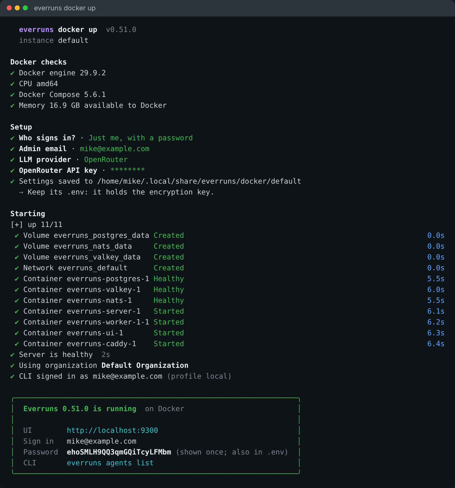

Setting up Everruns with [`everruns docker up`](/getting-started/docker-compose/)
or [`everruns k8s up`](/getting-started/kubernetes/) now reads like a checklist:
green ✔ for checks and answers, yellow warnings, red failures with the fix
under them, and one closing box with the address, sign-in, password and next
command.

`k8s up` shows each workload's ready count while Helm waits (`worker 0/1 ·
server 1/2`). `everruns k8s password` prints the admin password, and both
commands offer OpenRouter. `reset` is now `destroy`; on Kubernetes it also
removes the namespace when nothing else is in it.

The rest of the [CLI](/features/cli/) follows suit ([every command](/reference/cli/)).
Color is off when piped, with `--no-color`, `NO_COLOR`, `CLICOLOR=0` or
`TERM=dumb`; `CLICOLOR_FORCE=1` keeps it on.
