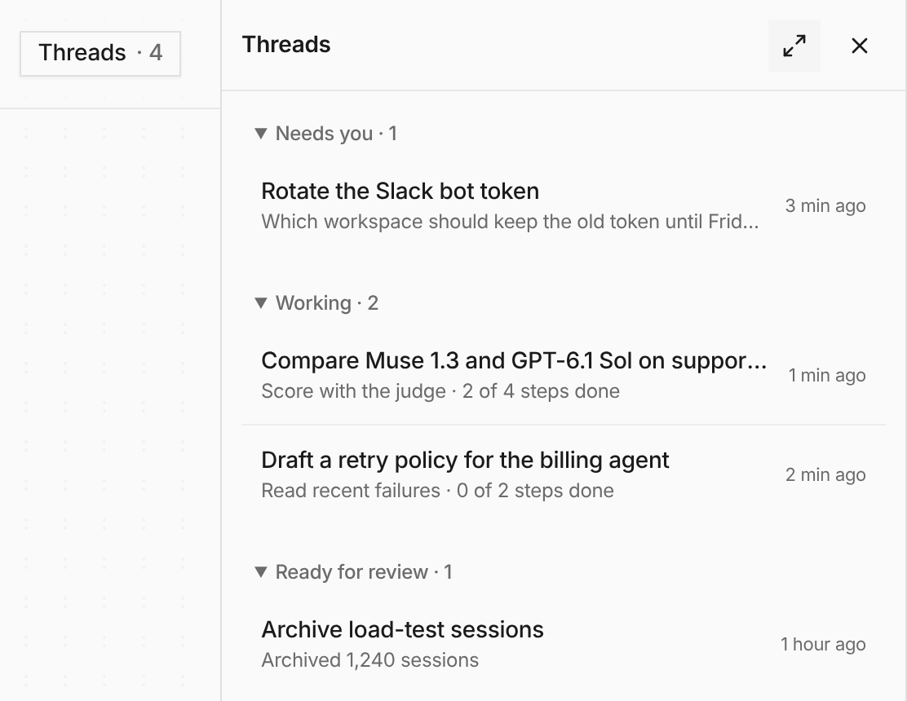

Ask **Main chat** for something long and it starts a thread, then keeps talking to
you while the thread works. **Threads** opens a panel on the right, sorted into
Needs you, Working and Ready for review. The panel opens when a new thread
starts. Click a thread to read it next to the chat.

**Side chats** replace subchats and can start their own threads. The
conversation sits beside the page in the default
[Chat first layout](/changelog/2026-11-11-chat-first-layout/). Cmd/Ctrl-Shift-J
toggles full screen. Chat workspace and background work are on for every
organization. Home is now **Overview**, under Building, with a count of the
items waiting there. See [Platform Chat](/built-ins/harnesses/platform-chat/).

## Update 2026-11-20

Main chat recovers from a rolled-back first attempt. Side chats open
independently of the Main chat lookup. Playground setup can also start a new
private Platform Chat.
