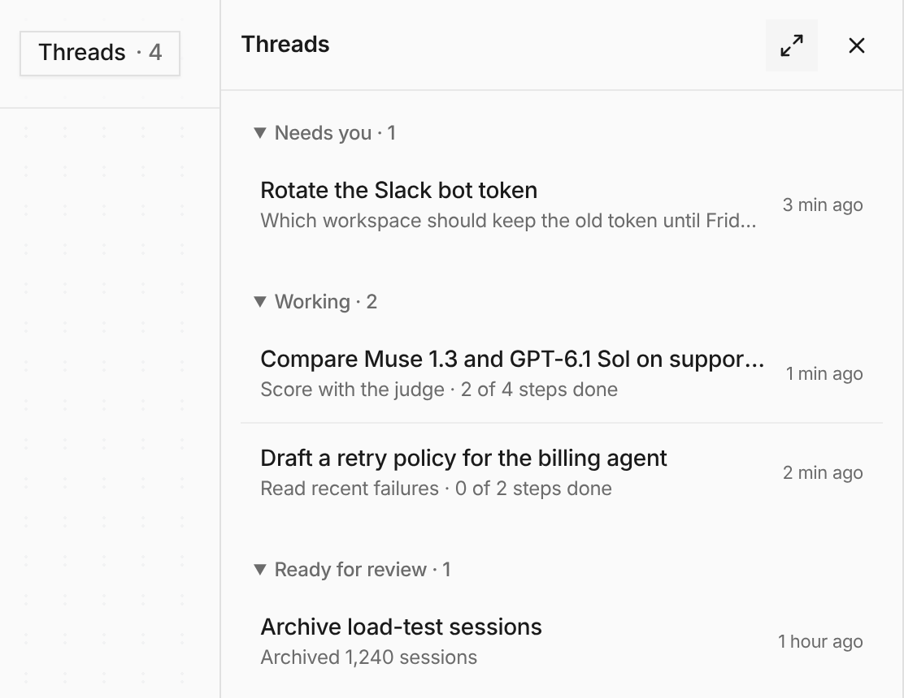

Ask **Main chat** for something long and it starts a thread, then keeps talking to
you while the thread works. **Threads** in the chat header opens a panel on the
right, sorted into Needs you, Working and Ready for review, and it opens by
itself when a new thread starts. Click a thread to read it next to the chat.

**Side chats** replace subchats and can start their own threads. On any page,
click Main chat in the sidebar or press Cmd/Ctrl-J and the conversation opens
beside that page; Cmd/Ctrl-Shift-J switches to full screen and back. This is
now on for every organization: the Chat workspace and Chat background work
opt-ins are gone. Home is now **Overview**, under Building, with a count of the
items waiting there. See [Platform Chat](/built-ins/harnesses/platform-chat/).
