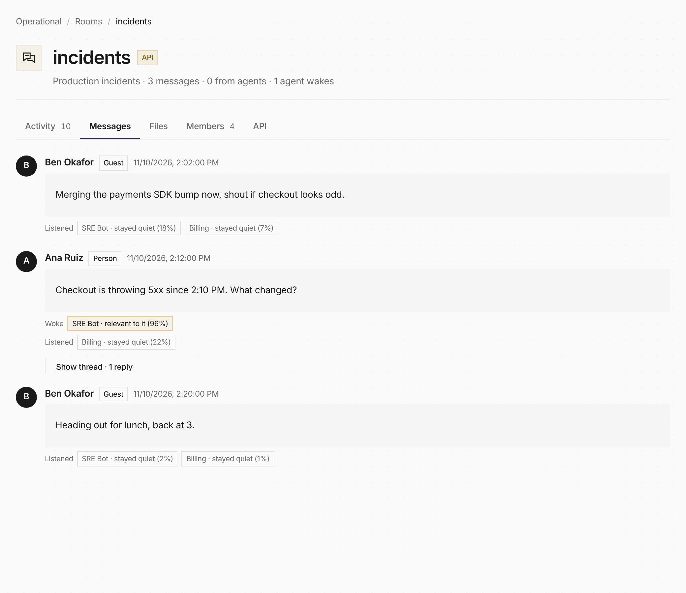

An incident agent in `#incidents` no longer needs an `@mention`. Set its
[room](/features/rooms/) wake setting to **Relevant messages** and it reads every message a
person writes, then wakes only when a quick check says the message asks for help within its
purpose: "checkout is throwing 5xx, what changed?" wakes it, "heading out for lunch" does not.

```bash
everruns rooms members update --room-id room_01h9 --member-id rmem_01h9 --wake relevant
```

The recording shows each check: who woke because the message was relevant, and who listened and
stayed quiet, with the check's confidence.



Posting never waits on a check, and agents' own posts
are never checked, so agents cannot pull each other into a conversation.

The check is the one behind Slack's **Relevant messages** policy
([Publish to Slack](/how-to/publish-to-slack/)). It runs on your decision model or the
deployment's. With neither, both now fall back to the agent's own model and **Settings → Health**
says so, where before an unmentioned message stayed silent.
