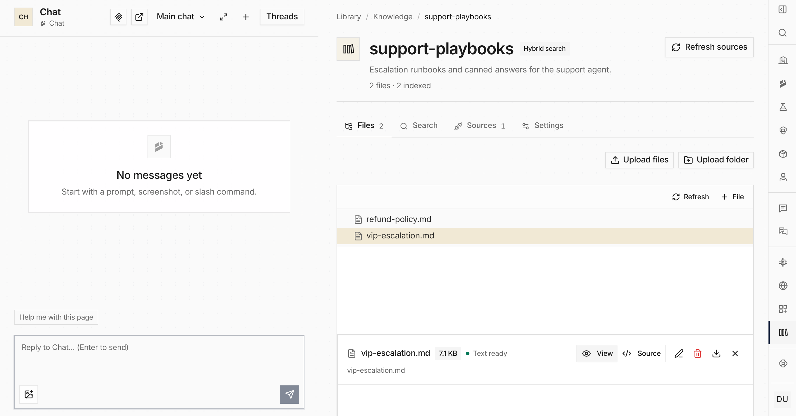

Open the app and you land on **Overview** with **Main chat** on the left, ready
to work on the page next to it. Navigation moves to a rail on the right edge:
grouped icons, the profile menu at the bottom, system pages and Settings under one
menu, and » to open the full sidebar.

Drag the divider between chat and page to resize it, double-click to reset, or
drag the chat to the edge for full screen. Threads open in the page pane, and the
browser's Back button returns to the page you came from.

Prefer the old sidebar? Choose **Classic** under **Layout** in the profile menu.
The choice follows you to every device and organization. See
[Platform Chat](/built-ins/harnesses/platform-chat/).
