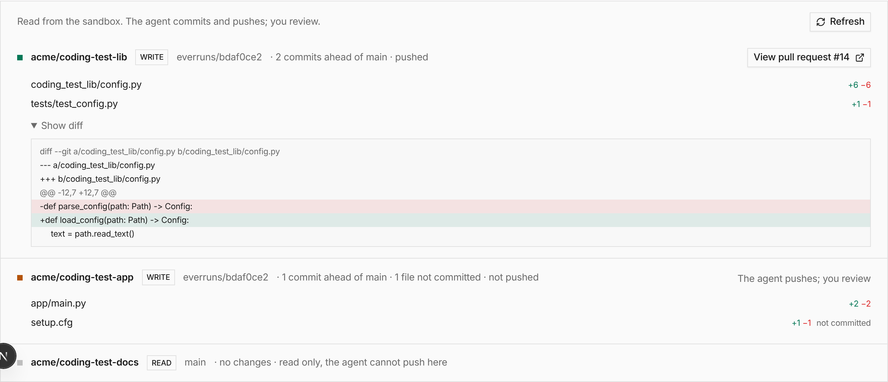

A change that renames a function in a library and fixes its callers in an app is now one session.
Add the [Repositories](/capabilities/repositories/) capability, or start from the beta `coding`
harness, and list what the agent works on:

```json
{
  "repositories": [
    {
      "repo": "acme/lib",
      "access": "write"
    },
    {
      "repo": "acme/app",
      "access": "write"
    },
    {
      "repo": "acme/docs"
    }
  ]
}
```

The session checks them out side by side in its sandbox, commits on one work branch per session,
pushes with `repo_push` and opens a pull request per repository. A push to a read-only repository
is refused. The agent's GitHub App token is minted per operation and never stays in the sandbox.
[Code navigation](/capabilities/code-navigation/) gives it a repository map, structural search and
language-server rename.

**In the UI:** pick repositories when you start a chat, and review every diff on the session's
**Changes** tab.


