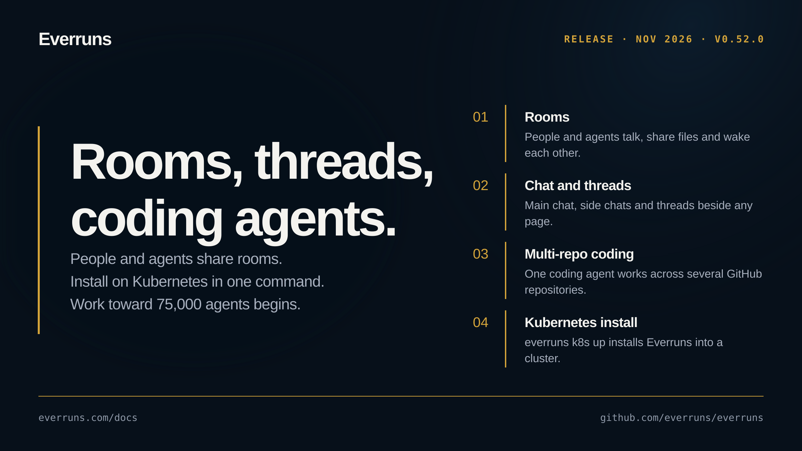

## Highlights

- **Rooms** - People and agents talk in one shared room. Agents wake when a message addresses them or is relevant to them, rooms keep versioned shared files, and the console shows the room live ([changelog](https://everruns.com/docs/changelog/2026-11-10-rooms/), [#5317](https://github.com/everruns/everruns/pull/5317), [#5326](https://github.com/everruns/everruns/pull/5326), [#5330](https://github.com/everruns/everruns/pull/5330), [#5342](https://github.com/everruns/everruns/pull/5342)).
- **Main chat, side chats and threads** - Chat with an agent beside any page, branch side chats and threads off it, and choose a chat-first layout per person ([changelog](https://everruns.com/docs/changelog/2026-11-10-main-chat-side-chats-threads/), [#5322](https://github.com/everruns/everruns/pull/5322), [#5346](https://github.com/everruns/everruns/pull/5346)).
- **Coding agents across several repositories (beta)** - One coding agent checks out several GitHub repositories, navigates code with language servers and structural search, and opens pull requests; pick repositories in agent settings and new chats, and review the Changes tab ([changelog](https://everruns.com/docs/changelog/2026-11-11-coding-agents-several-repositories/), [#5311](https://github.com/everruns/everruns/pull/5311), [#5307](https://github.com/everruns/everruns/pull/5307), [#5327](https://github.com/everruns/everruns/pull/5327), [#5329](https://github.com/everruns/everruns/pull/5329), [#5354](https://github.com/everruns/everruns/pull/5354)).
- **Install on Kubernetes** - `everruns k8s up` installs Everruns into a cluster, the Helm chart upgrades several servers without downtime, `docker up --tunnel` gives a local instance a public address, and Slack connects over Socket Mode ([changelog](https://everruns.com/docs/changelog/2026-11-08-everruns-k8s-up/), [#5277](https://github.com/everruns/everruns/pull/5277), [#5275](https://github.com/everruns/everruns/pull/5275), [#5276](https://github.com/everruns/everruns/pull/5276), [#5279](https://github.com/everruns/everruns/pull/5279)).
- **Work toward 75,000 agents begins** - We started the milestone of running 75,000 agents at once: workers admit turns by memory instead of fixed slots, turn paths read less from the database, and the first steps of a cell-based data plane landed ([changelog](https://everruns.com/docs/changelog/2026-11-06-workers-run-thousands-of-turns/), [#5245](https://github.com/everruns/everruns/pull/5245), [#5257](https://github.com/everruns/everruns/pull/5257), [#5320](https://github.com/everruns/everruns/pull/5320), [#5356](https://github.com/everruns/everruns/pull/5356)).
- **Device-bound browser sessions** - In Chrome, a sign-in is bound to a key in the device's secure hardware, so a stolen session cookie stops working within minutes ([changelog](https://everruns.com/docs/changelog/2026-11-10-device-bound-sessions/), [#5338](https://github.com/everruns/everruns/pull/5338)).

## Upgrade notes

- `POST /v1/orgs/{org}/members` now returns `403` unless the caller is a platform admin; add people with `POST /v1/orgs/{org}/invites` instead. Callers that name no organization land in the one the user joined first ([changelog](https://everruns.com/docs/changelog/2026-11-07-org-members-join-by-invitation/), [#5261](https://github.com/everruns/everruns/pull/5261)).

## In the changelog

- [See human waiting time separately in traces](/changelog/2026-11-06-human-wait-traces/)
- [Workers run thousands of turns at once](/changelog/2026-11-06-workers-run-thousands-of-turns/)
- [Start turns while slow MCP servers connect](/changelog/2026-11-07-mcp-readiness-budget/)
- [Organization members now join only by invitation](/changelog/2026-11-07-org-members-join-by-invitation/)
- [A2A callers sharing an endpoint now see only their own tasks](/changelog/2026-11-08-a2a-tasks-per-caller/)
- [Give a local Everruns a public address with one flag](/changelog/2026-11-08-docker-up-public-address/)
- [Install on Kubernetes with everruns k8s up](/changelog/2026-11-08-everruns-k8s-up/)
- [Upgrade a Kubernetes install without downtime](/changelog/2026-11-08-helm-chart-several-servers/)
- [Schedules fire in their own timezone](/changelog/2026-11-08-schedule-timezones/)
- [Slack agents on your own computer, no public address](/changelog/2026-11-08-slack-socket-mode/)
- [Attach a second terminal to a running Framework session](/changelog/2026-11-09-attach-running-sessions/)
- [cancel_task returns the task after cancellation](/changelog/2026-11-09-cancel-task-result/)
- [Claude Fable 5.2 and Mythos 5.2 models added for Anthropic providers](/changelog/2026-11-09-claude-fable-mythos-5-2/)
- [Session exports hide cookies in command text](/changelog/2026-11-09-cookie-text-redaction/)
- [Narrate your own Framework tools](/changelog/2026-11-09-framework-tool-narration/)
- [Invisible controls are visible in MCP descriptions](/changelog/2026-11-09-mcp-description-controls/)
- [Read MCP server readiness and reconnect from a Framework session](/changelog/2026-11-09-mcp-readiness-api/)
- [Muse Ember, Meta's cheapest Muse model, is available in Everruns](/changelog/2026-11-09-muse-ember/)
- [Point research agents at one organization research model](/changelog/2026-11-09-org-research-model/)
- [A CLI you can read at a glance](/changelog/2026-11-10-cli-at-a-glance/)
- [Models only lists the providers you connected](/changelog/2026-11-10-connected-providers-only/)
- [Browser sessions are bound to the device in Chrome](/changelog/2026-11-10-device-bound-sessions/)
- [Framework agents finish the work they announce](/changelog/2026-11-10-framework-completion-check/)
- [Main chat, side chats and threads, beside any page](/changelog/2026-11-10-main-chat-side-chats-threads/)
- [Room agents can step in when a message is for them](/changelog/2026-11-10-room-agents-relevant-messages/)
- [Rooms keep shared files and join the Everruns MCP server](/changelog/2026-11-10-room-files/)
- [Rooms put people and agents in one conversation](/changelog/2026-11-10-rooms/)
- [Watch agents work together in a room, from the console](/changelog/2026-11-10-rooms-console/)
- [Local sessions use separate SQLite databases](/changelog/2026-11-10-session-owned-sqlite/)
- [Chat first layout: Main chat beside every page, navigation at right](/changelog/2026-11-11-chat-first-layout/)
- [Coding agents that work across several GitHub repositories](/changelog/2026-11-11-coding-agents-several-repositories/)
- [Slack replies render Markdown everywhere, and never ping @here](/changelog/2026-11-11-slack-markdown-everywhere/)

[GitHub release](https://github.com/everruns/everruns/releases/tag/v0.52.0) · [Full release notes](https://github.com/everruns/everruns/blob/v0.52.0/CHANGELOG.md#0520---2026-11-11)
