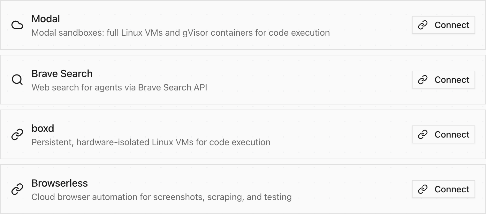

[Modal](/integrations/modal/), Browserless [browser use](/capabilities/browser-use/) and
computer use are available without feature toggles. Add the capability to an agent and
connect your own provider account. Credentials and tool authorization remain required.



MCP Events subscriptions are also built in:

```json
{
  "jsonrpc": "2.0",
  "id": 1,
  "method": "events/list",
  "params": {}
}
```

Send this request to the authenticated `/mcp` endpoint. Subscription ownership,
callback verification and delivery permissions still apply.

The retired Browserless, Modal and MCP Events flags no longer affect availability.
Agent changes always require a reason; the warning-only opt-out is removed.
People and ordinary API callers keep their existing rules. Observers and evals
retain their adoption defaults and organization opt-in.

Sprites and its tools are removed. Before upgrading, close existing Sprites resources
in the provider account and move agents to another sandbox provider. Existing Sprites
credentials remain protected in storage.
