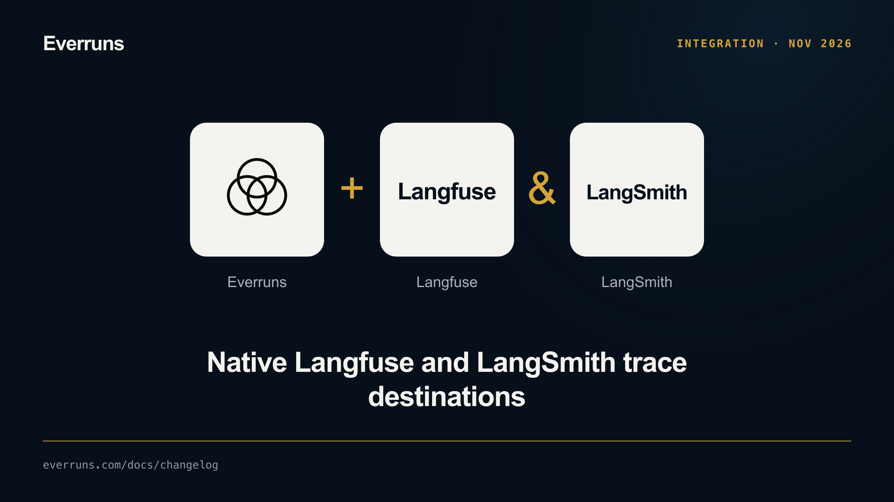
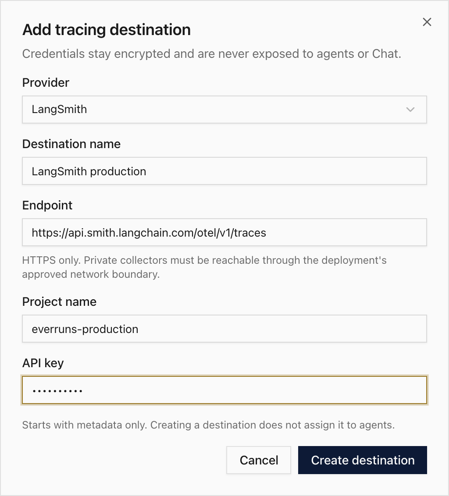

Choose **Langfuse** or **LangSmith** in **Settings → Tracing → Add destination**.
Langfuse accepts a public and secret key; LangSmith accepts a workspace-scoped API
key with either a project name or a registered agent and environment. Regional and self-hosted HTTPS endpoints are supported.

Set organization defaults, then let each agent inherit, add, replace, or disable
those destinations. Braintrust and generic OTLP remain available through the same
routing controls. Credentials are write-only and encrypted; new destinations
start with metadata only. Messages, tool content, and reasoning require explicit
capture settings. Export failures do not stop agent execution.

The screenshot shows an isolated local UI preview with example credentials, not
a live provider connection. See [tracing destinations](/observability/destinations/)
for setup, privacy controls, and best-effort delivery limits.
