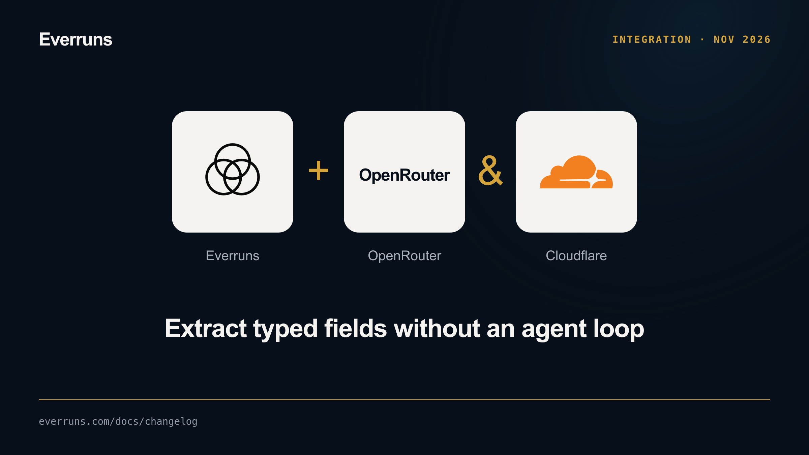
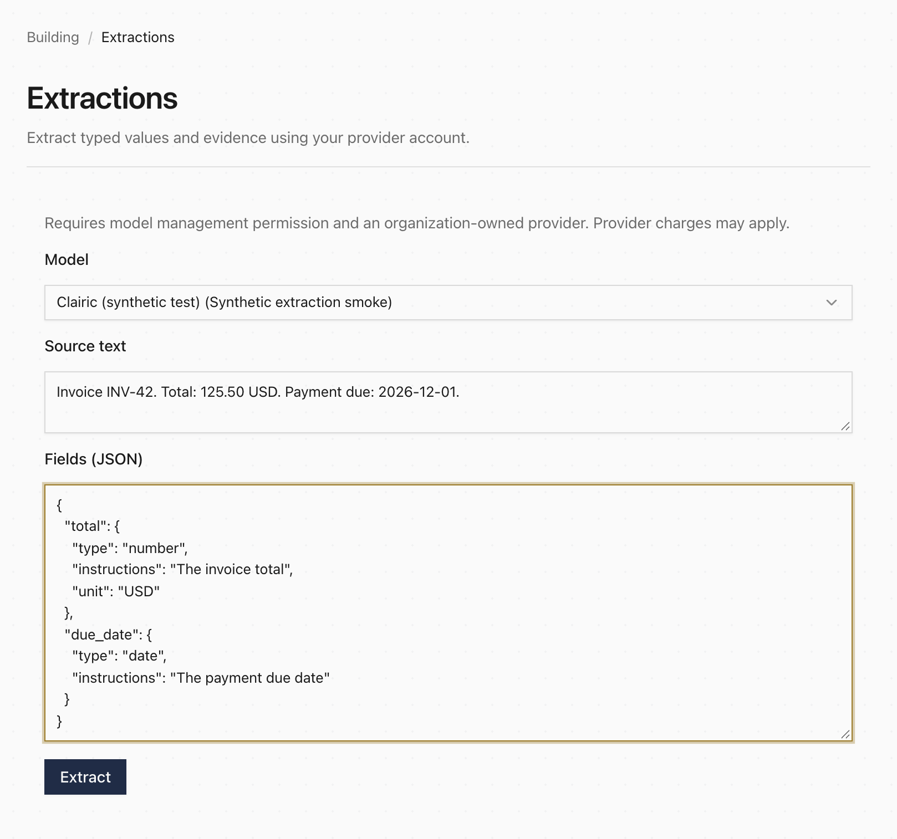

**In code:** The Framework exposes `Extractions` for typed fields through OpenRouter's alpha Extractions API or Cloudflare's Clairic model. Results preserve missing values, confidence, source spans, truncation and usage instead of turning a chat answer into evidence.

**In the UI:** The Server exposes `POST /v1/extractions`, and the console has an **Extractions** page for text and field specifications. Calls use an enabled extraction-capable model and organization-owned provider credentials. Hosted/billed models are not supported; unsupported requests fail instead of falling back to chat.



See [Typed Extractions](/framework/extractions/) for configuration, evidence semantics and examples.

```rust
use everruns::{ExtractionField, Extractions};

async fn extract_invoice() -> Result<(), Box<dyn std::error::Error>> {
    let provider = everruns_drivers::openrouter::provider(
        "openrouter", std::env::var("OPENROUTER_API_KEY")?,
    );
    let result = Extractions::new("cloudflare/clairic", provider)
        .about("Invoice INV-42")
        .field("invoice_number", ExtractionField::text())
        .send().await?;
    println!("{:?}", result.answers);
    Ok(())
}
```

## Update 2026-11-18

The extraction API and console now require organization adoption. Enable
**Extractions** in **Settings → Features** before using the form or
`POST /v1/extractions`. The sidebar lists Extractions at the end of Build
when the feature is enabled and the viewer can manage models.
