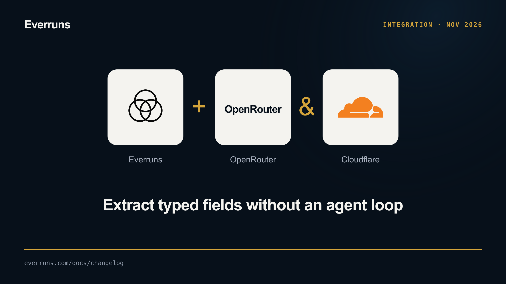
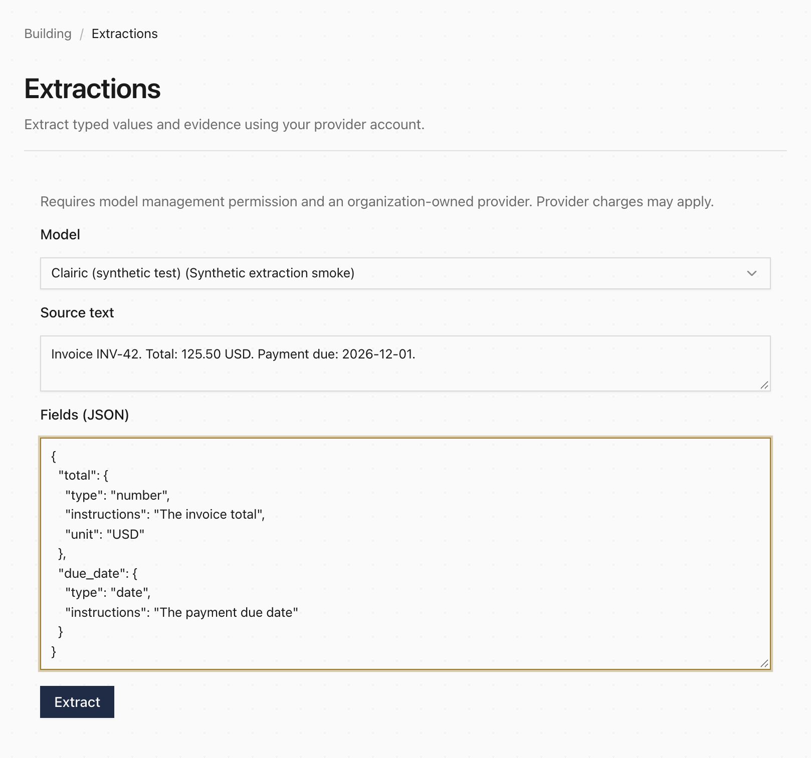

**In code:** The Framework now exposes `Extractions` for named text, number, date, list and other typed fields. Native drivers call OpenRouter's alpha Extractions API or Cloudflare's Clairic model directly. Results preserve missing values, optional confidence, source spans, truncation and usage rather than converting a chat answer into evidence.

**In the UI:** The Server exposes `POST /v1/extractions`, and the console has an **Extractions** page for text and field specifications. Calls use an enabled extraction-capable model and organization-owned provider credentials. Hosted/billed models are not supported by this initial endpoint. Provider field and asset support differ; unsupported requests fail instead of falling back to chat.



See [Typed Extractions](/framework/extractions/) for configuration, evidence semantics, examples and opt-in live tests. This source change does not imply availability in a published release or deployed Cloud.

Enable `everruns`’ `utility-llm` feature and `everruns-drivers`’ `openrouter` feature.

```rust
use everruns::{ExtractionField, Extractions};

async fn extract_invoice() -> Result<(), Box<dyn std::error::Error>> {
    let provider = everruns_drivers::openrouter::provider(
        "openrouter", std::env::var("OPENROUTER_API_KEY")?,
    );
    let result = Extractions::new("cloudflare/clairic", provider)
        .about("Invoice INV-42")
        .field("invoice_number", ExtractionField::text())
        .send().await?;
    println!("{:?}", result.answers);
    Ok(())
}
```
