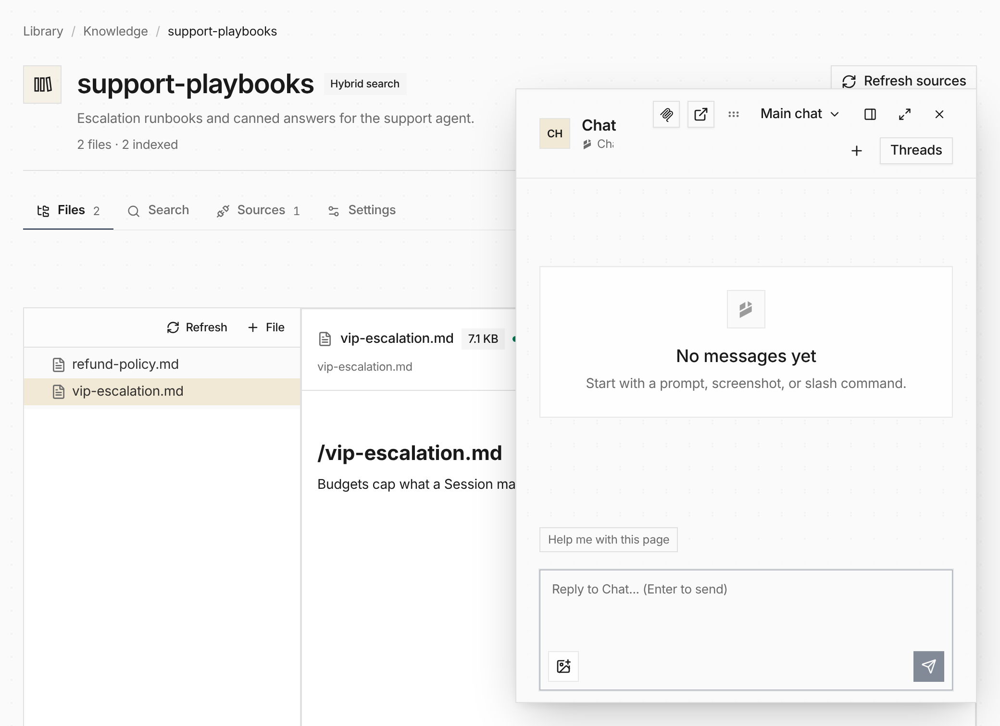

Classic, with the left sidebar, is the default layout again. Chat no longer has
to take over the screen: under **Chat in Classic** in the profile menu's
**Layout**, pick **Floating** for a card you can drag anywhere and resize from
its corner, or **Docked** for a column on the right with a divider you can drag.

Either way Chat sees the page next to it, drafts changes right on the page, and
opens threads in the page pane. **Command-J** (**Ctrl-J**) shows or hides it,
**Command-Shift-J** goes full screen, and one header button swaps floating and
docked. The choice is saved to your account, so it follows you to every device.
See [Platform Chat](/built-ins/harnesses/platform-chat/).
