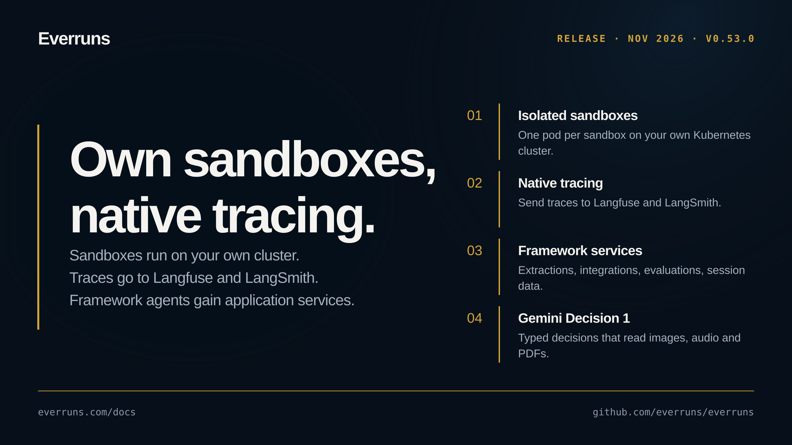

## Highlights

- **Isolated sandboxes on your own cluster** - A self-hosted Everruns runs agent sandboxes itself: one pod per sandbox on the deployment's own Kubernetes cluster, with its own kernel under AWS Nitro Sandboxes, gVisor or Kata, egress enforced by NetworkPolicy, pause and resume that keep the workspace, and a desktop image, with no sandbox provider account ([changelog](https://everruns.com/docs/changelog/2026-11-15-isolated-sandboxes/), [#5417](https://github.com/everruns/everruns/pull/5417)).
- **Native tracing to Langfuse and LangSmith** - Send agent traces to Langfuse and LangSmith with organization defaults, per-agent routing, encrypted credentials and explicit content capture ([changelog](https://everruns.com/docs/changelog/2026-11-12-native-tracing-destinations/), [#5394](https://github.com/everruns/everruns/pull/5394)).
- **Framework application services** - Framework agents extract typed fields without an agent loop, connect to GitHub, MCP and Slack with application credentials, project traces and run evaluations, route event triggers, keep session SQL and memory, drive E2B sandboxes, and can cancel one running tool call without ending the turn ([changelog](https://everruns.com/docs/changelog/2026-11-13-native-extractions/), [changelog](https://everruns.com/docs/changelog/2026-11-15-framework-authenticated-integrations/), [changelog](https://everruns.com/docs/changelog/2026-11-15-framework-evaluation-trace-projection/), [changelog](https://everruns.com/docs/changelog/2026-11-15-framework-session-data-services/), [#5397](https://github.com/everruns/everruns/pull/5397), [#5408](https://github.com/everruns/everruns/pull/5408), [#5384](https://github.com/everruns/everruns/pull/5384)).
- **Gemini Decision 1** - Google's decision model answers typed decisions under a Gemini or OpenRouter provider, reads attached images, audio, video and PDFs, and can answer a deployment's guardrail checks ([changelog](https://everruns.com/docs/changelog/2026-11-12-gemini-decision-1/), [changelog](https://everruns.com/docs/changelog/2026-11-12-gemini-decisions-media/), [#5371](https://github.com/everruns/everruns/pull/5371), [#5373](https://github.com/everruns/everruns/pull/5373)).
- **Classic layout with floating or docked Chat** - Classic is the default layout again, and its Chat can float over the page or dock beside it while still seeing the page ([changelog](https://everruns.com/docs/changelog/2026-11-15-classic-floating-docked-chat/), [#5402](https://github.com/everruns/everruns/pull/5402), [#5403](https://github.com/everruns/everruns/pull/5403)).
- **Shell Code Mode** - Tools in Shell is now Shell Code Mode, MCP replies print as plain JSON for `jq`, and a new example drives a 1,000-tool MCP server from one script ([changelog](https://everruns.com/docs/changelog/2026-11-15-shell-code-mode/), [changelog](https://everruns.com/docs/changelog/2026-11-15-shell-code-mode-mcp-json/), [#5415](https://github.com/everruns/everruns/pull/5415), [#5418](https://github.com/everruns/everruns/pull/5418), [#5412](https://github.com/everruns/everruns/pull/5412)).
- **Work toward 75,000 agents continues** - Sessions on the cell-based data plane now run end to end through the edge, cells recover from losing their storage node, and production-shaped load runs on EKS ([#5364](https://github.com/everruns/everruns/pull/5364), [#5375](https://github.com/everruns/everruns/pull/5375), [#5385](https://github.com/everruns/everruns/pull/5385)).

## Upgrade notes

- Browserless, Modal and MCP Events no longer need feature flags; observers and evals keep organization opt-in. Agent changes always require a reason, with no warning-only opt-out. The Sprites sandbox integration is removed: close Sprites resources in the provider account and move agents to another sandbox provider before upgrading ([changelog](https://everruns.com/docs/changelog/2026-11-12-built-in-integrations/), [#5380](https://github.com/everruns/everruns/pull/5380)).

## In the changelog

- [Browserless, Modal and MCP Events become built in](/changelog/2026-11-12-built-in-integrations/)
- [Framework sessions can stop one tool call](/changelog/2026-11-12-framework-cancel-tool-call/)
- [Gemini Decision 1 answers typed decisions](/changelog/2026-11-12-gemini-decision-1/)
- [Gemini decisions read images, audio, video and PDFs](/changelog/2026-11-12-gemini-decisions-media/)
- [Native Langfuse and LangSmith trace destinations](/changelog/2026-11-12-native-tracing-destinations/)
- [Private approval cards for Slack requesters](/changelog/2026-11-12-private-slack-approvals/)
- [Extract typed fields without an agent loop](/changelog/2026-11-13-native-extractions/)
- [Shorter responses for unchanged task polls](/changelog/2026-11-13-task-polling-snapshots/)
- [Compaction reserves context for tool schemas](/changelog/2026-11-13-tool-schemas-context-budget/)
- [Classic layout: keep Chat floating or docked beside the page](/changelog/2026-11-15-classic-floating-docked-chat/)
- [Framework connects to GitHub, MCP and Slack](/changelog/2026-11-15-framework-authenticated-integrations/)
- [Framework shares trace projection and evaluation](/changelog/2026-11-15-framework-evaluation-trace-projection/)
- [Framework event triggers and native services](/changelog/2026-11-15-framework-events-native-services/)
- [Framework session data and sandbox tools](/changelog/2026-11-15-framework-session-data-services/)
- [Run agent sandboxes as their own VMs on your Kubernetes cluster](/changelog/2026-11-15-isolated-sandboxes/)
- [MCP workspaces preserve drafts and recover connections](/changelog/2026-11-15-mcp-workspace-reliability/)
- [Tools in Shell is now Shell Code Mode](/changelog/2026-11-15-shell-code-mode/)
- [Shell Code Mode prints MCP replies as plain JSON](/changelog/2026-11-15-shell-code-mode-mcp-json/)

[GitHub release](https://github.com/everruns/everruns/releases/tag/v0.53.0) · [Full release notes](https://github.com/everruns/everruns/blob/v0.53.0/CHANGELOG.md#0530---2026-11-15)
