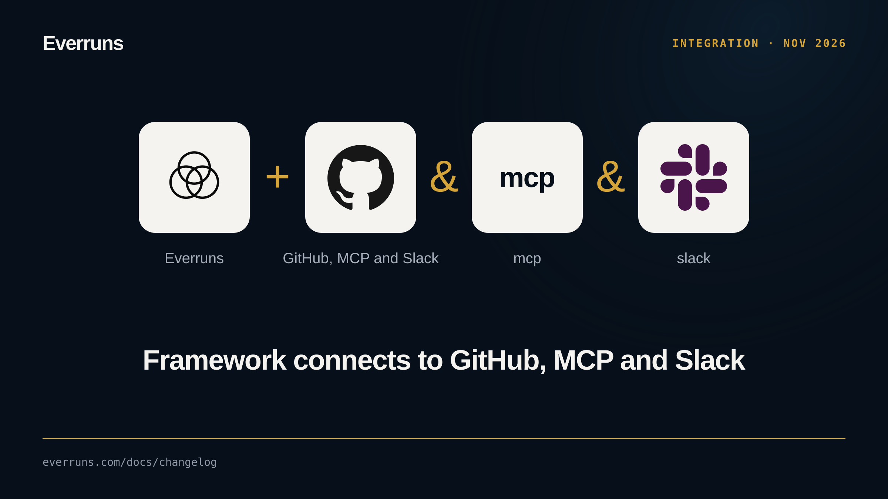

Framework applications can use GitHub operations, MCP OAuth and Slack services without Server account records. Credentials stay outside serialized agent configuration; writes and channel affordances are explicit opt-ins.

With the `github` Cargo feature:

```rust
use everruns::github::GitHub;

let github = GitHub::from_env()?.allow_writes(true);
# Ok::<(), Box<dyn std::error::Error>>(())
```

[GitHub tools](/framework/github/) shares vendor operations and supports rotating credentials. [MCP authentication](/framework/mcp-authentication/) adds PKCE login, endpoint-bound grants and shared token refresh. [Slack services](/framework/slack-services/) adds native actions, file uploads, agent-pane delivery, approvals, history and application participation policies, with runnable real-model examples.

## Update 2026-11-15

Server browser connections and Framework OAuth now call one protocol client for discovery, registration, PKCE, code exchange and refresh. Both retain discovery fallbacks and reject issuer mismatches. Provider bodies and credentials stay out of OAuth errors; Server keeps encrypted grants, organization-scoped requests and cross-replica rotation locks. The [sharing matrix](/framework/service-integrations/#shared-implementations-and-host-boundaries) identifies shared operations and host responsibilities.
