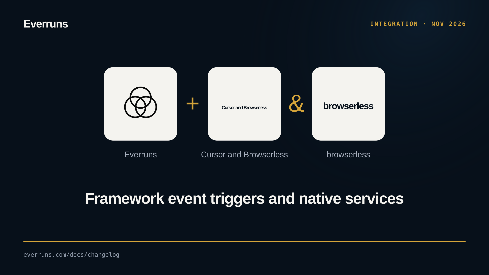

Framework applications can route events through shared filters, change detection and templates, with a durable outbox and stable Engine input identities. GitHub and MCP adapters authenticate deliveries before normalization. Applications retain scheduling and subscription ownership.

With the `triggers` Cargo feature:

```rust
use everruns::triggers::SqliteStore;

let outbox = SqliteStore::open("private-triggers.sqlite")?;
# Ok::<(), Box<dyn std::error::Error>>(())
```

[Event triggers](/framework/event-triggers/) explains recovery and session routing. [Native services](/framework/native-services/) provides explicit application credentials for Cursor and Browserless, using their existing native operations. Complete real-model examples cover dispatch, browser cleanup and vendor calls.
