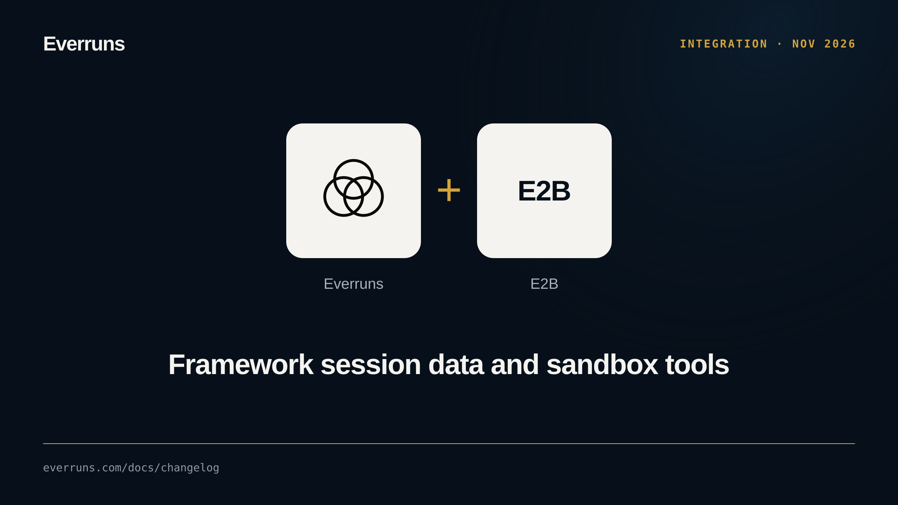

Framework agents can use persistent session SQL, named memory directories and application-owned knowledge retrieval. SQL reuses the Server authorizer and execution limits; retrieval returns bounded passages with citation provenance.

With the `sql-database` Cargo feature:

```rust
use everruns::database::SqlDatabase;

let databases = SqlDatabase::open("private-session-databases")?;
# Ok::<(), Box<dyn std::error::Error>>(())
```

[Data services](/framework/data-services/) shows the agent bindings and storage isolation. The optional E2B binding adds create, execute, files, pause, resume and delete operations with application credentials; [native services](/framework/native-services/) includes the runnable sandbox example and cleanup responsibilities.
