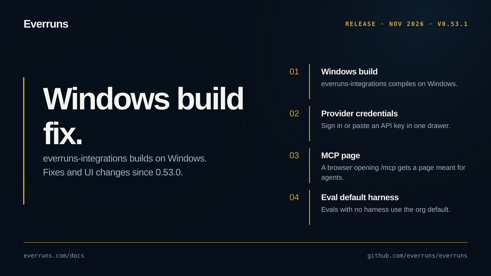

A patch release on top of [0.53.0](/changelog/2026-11-15-everruns-0-53-0/).

- **Windows build**: `everruns-integrations` 0.53.0 does not compile on Windows when `kubernetes-sandbox` is on, which `everruns-capabilities`' `hosted-integration-catalog` feature turns on. The sandbox guest server is now Unix-only, and the client the Kubernetes provider uses stays portable ([#5443](https://github.com/everruns/everruns/pull/5443)).
- **Provider credentials drawer**: connecting a provider that supports sign-in asks whether to sign in or paste an API key, in one drawer that also replaces a key ([#5444](https://github.com/everruns/everruns/pull/5444)).
- **MCP page for browsers**: opening the `/mcp` URL in a browser shows a page with the URL to copy and setup commands for MCP clients. MCP clients and OAuth discovery see no change ([#5446](https://github.com/everruns/everruns/pull/5446)).
- **Evals without a harness**: an eval whose target names no harness runs on the agent's harness, then the org default, instead of failing every case ([#5406](https://github.com/everruns/everruns/pull/5406)).
- **Monitoring on cells**: organizations on the cell data plane open Monitoring on Timeline, without the always-empty Execution tab ([#5442](https://github.com/everruns/everruns/pull/5442)).

All published crates ship at 0.53.1. See the [GitHub release](https://github.com/everruns/everruns/releases/tag/v0.53.1) and the [full release notes](https://github.com/everruns/everruns/blob/v0.53.1/CHANGELOG.md#0531---2026-11-16).
