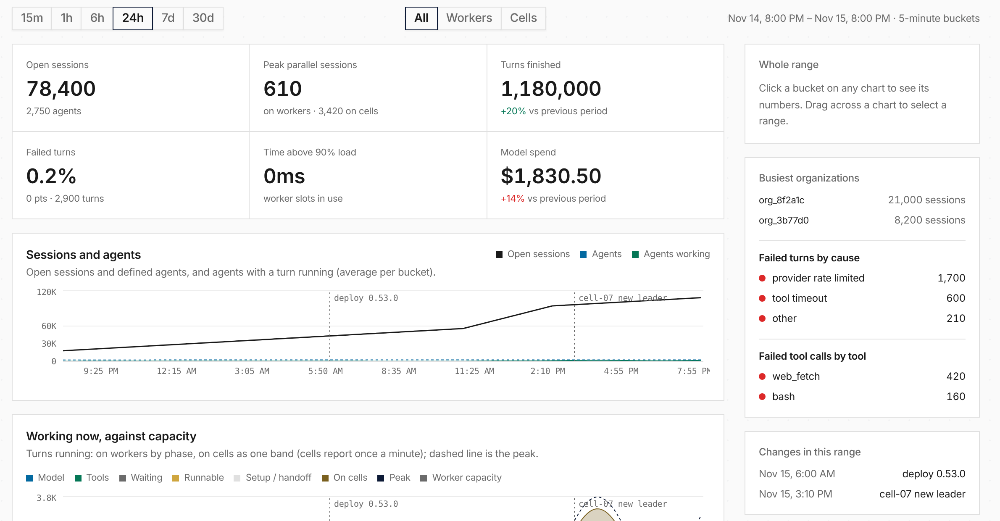

**Monitoring → Timeline** answers "what happened at 3 PM" on one screen: open
sessions, agents, turns, failed turns and spend share a time axis with deploy
and leader-change markers. **What failed** lists failed turns by cause and failed
tool calls by tool.

An organization sees only the path it runs on: its sessions on shards, or the
worker view. The platform view has both, a fleet chart of servers, workers,
shards and nodes, and a **Shards** tab with each shard's latest minute and history.

History is kept in PostgreSQL, one row a minute, with no metrics database. For
10-second, per-node detail, point the server at VictoriaMetrics:

```bash
MONITORING_DETAIL=prometheus
MONITORING_DETAIL_URL=http://victoriametrics:8428
```

See [Monitoring](/observability/monitoring/) and [environment variables](/sre/environment-variables/).
