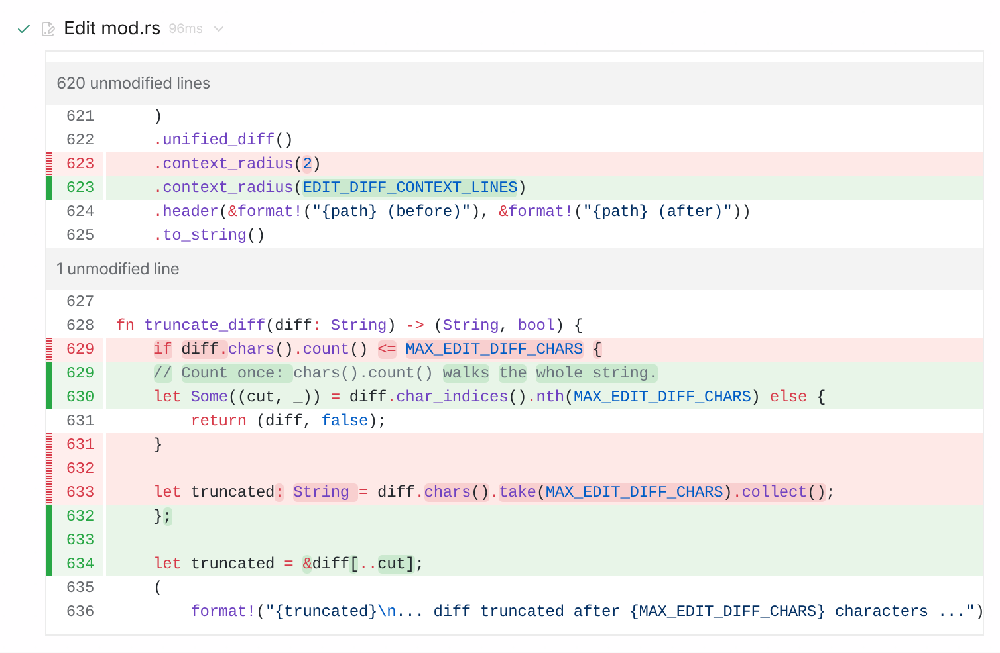

When an agent changes a file with `edit_file`, its card in the chat now starts
with the size of the change, such as **+6 −5 · 2 edits · line 623**. Expand the
card to see a real diff: syntax highlighting for the file's language, old and new
line numbers, the changed words marked inside each line, and folded unchanged
code. The diff follows the console's light or dark theme. It loads only when you
open a card, so long coding sessions don't get slower to load. Before this, the
card showed the patch as plain grey text.

The diff comes from the same result `edit_file` already returns. See
[Read tools](/built-ins/read-tools/) for how reads and edits work together.
