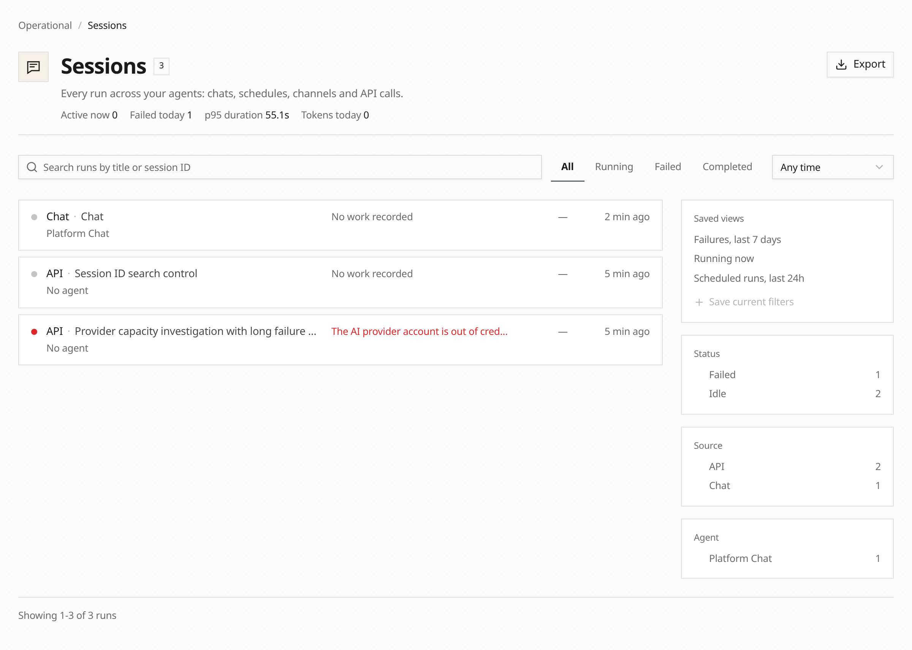

Paste a complete `session_…` ID into the **Sessions** search field to find that
run directly, without depending on its generated title. The ID path is an exact
indexed lookup, while ordinary text keeps the existing title search behavior.

Long failure messages now stay inside the outcome column and end with an
ellipsis instead of overlapping duration and date. Hover the shortened message
to read it in full.

See [Web UI](/features/ui/) for the Sessions surface.
