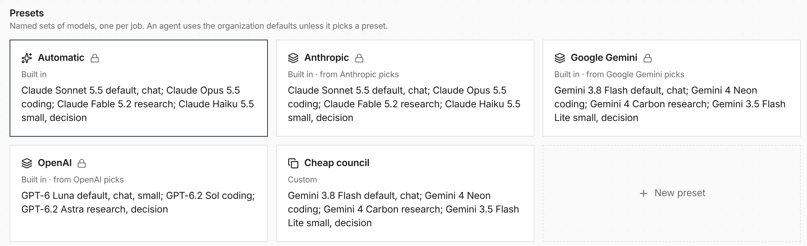

The **Models** page has a new **Presets** tab. A preset names a model for each
job: default, chat, coding, research, small work and decisions. Every
organization gets **Automatic** plus a read-only preset per connected
provider, such as **Gemini**, filled from its recommended models. Duplicate
one to change single jobs.



An agent's **Models from** switches it from the organization defaults to a
preset, and **Copy to organization defaults** writes a preset into the
Defaults tab, which also gains a **Coding model** row. The same works from the
API, MCP and CLI, see [Model presets](/providers/#model-presets):

```bash
everruns model-presets list
everruns agents update agent_01h9 --name reviewer --instructions "Review the diff" --model-preset provider:gemini
```
