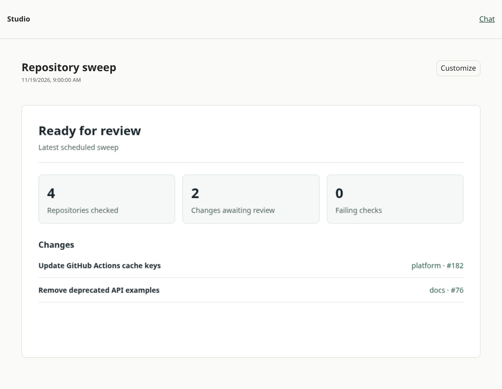

Enable **Agent views** in organization Features, then open **More → Views** in
the Agent editor. Choose an A2UI or HTML layout, declare its data fields, and
preview it. Add the **Published views** capability so successful scheduled runs
can update the view.

For example, a scheduled housekeeping Agent can call `publish_view` with data
for the configured `checked` and `status` fields.

```json
{
  "data": {
    "checked": 4,
    "status": "Two changes need review"
  }
}
```

Open the view in Platform Chat or share it in a [Work Chat channel](/features/channels/)'s side panel
or landing page. If the author enables personalization, each signed-in viewer
can preview and save their own layout.


