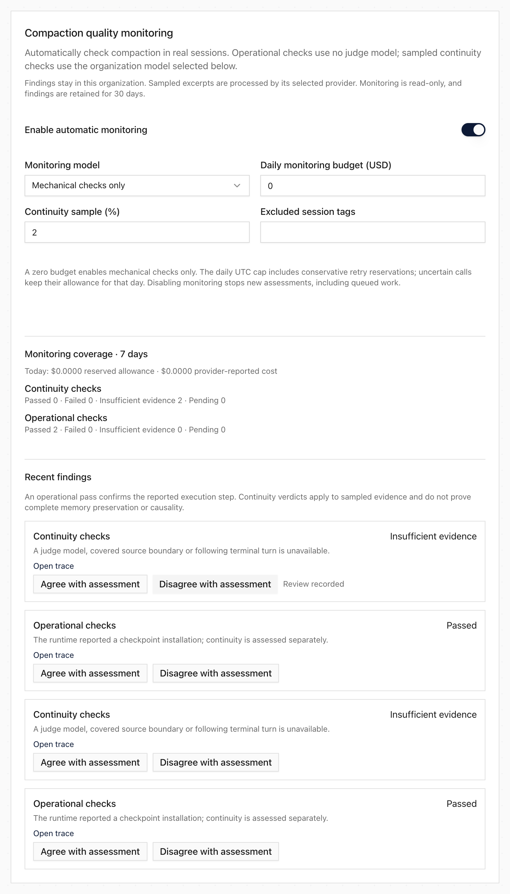

Enable **Compaction quality monitoring** in Organization settings. Operational
checks use no judge model. Choose an organization model, sample percentage and
daily allowance to assess continuity using bounded source and continuation
excerpts, including sessions that keep running indefinitely.

The panel separates operational results from continuity verdicts and insufficient
evidence. Open a finding's trace and record agreement or disagreement. Monitoring
is off by default, respects excluded tags, retains findings for 30 days and never
changes your agent. Native checkpoint contents remain opaque; a sampled pass is
not proof of complete memory preservation.

```json
{
  "quality_monitoring": {
    "enabled": true,
    "daily_budget_usd": 0
  }
}
```

Send this policy with the organization PATCH API for mechanical checks only. See
[Context compaction](/advanced/compaction/) for consent, pricing reservations and
Framework integration.


