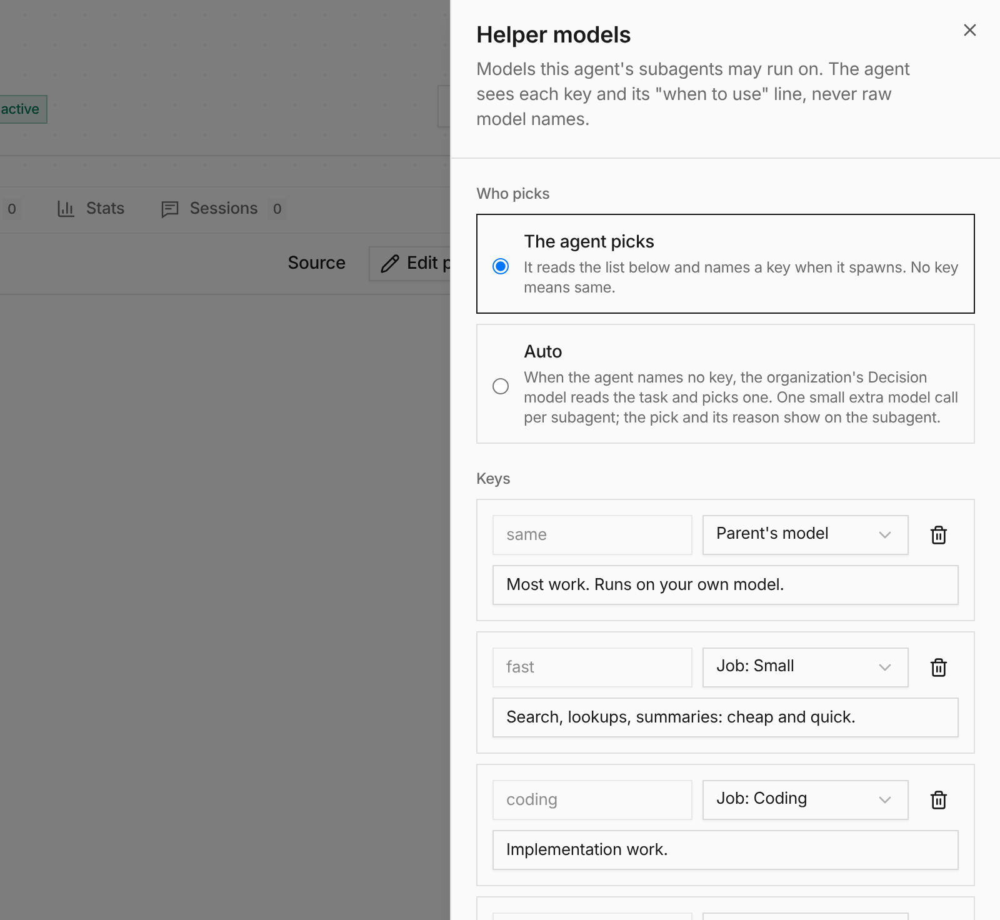

A builder on GPT-6.2 Sol can now hand its diff to a verifier on another
provider, and its lookups to a small model. `spawn_agent` takes a `model`: one
of the agent's **helper models**, keys such as `fast`, `deep` and
`second_opinion`, each with a line on when to use it. The agent never names a
raw model, so the owner decides what subagents cost and which providers see
the data.

Keys point at jobs, not models: `second_opinion` follows the Default job of a
provider other than the parent's. Add your own keys, or switch to **Auto** and
let the Decision model pick one. The **Subagents** tab shows each subagent's
key, model and who picked it.

A child also keeps the model you chose for the parent chat instead of falling
back to the agent's default. See [Helper models](/capabilities/sub-agents/#helper-models).
