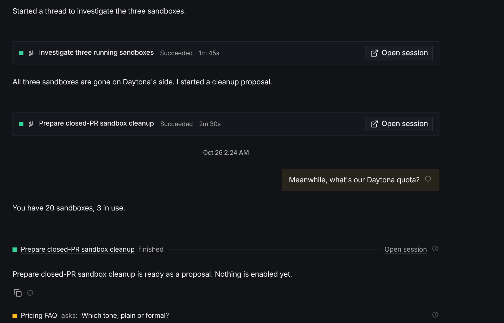

When a thread finished, Chat used to add a row under its card with the thread's
whole report, task id and all. That text was written for the coordinator, not for you.

Now the report stays in the thread. If the coordinator answers right after the
thread's card, nothing extra appears: the card already says **Succeeded** or
**Failed**, and the reply is your summary. If the chat moved on in between, one
line says which thread finished, failed, or asks a question, with **View thread**
beside it. Progress messages from a running thread no longer show at all. The
coordinator still receives the full text, and the message info icon shows it
under **What the agent received**.

