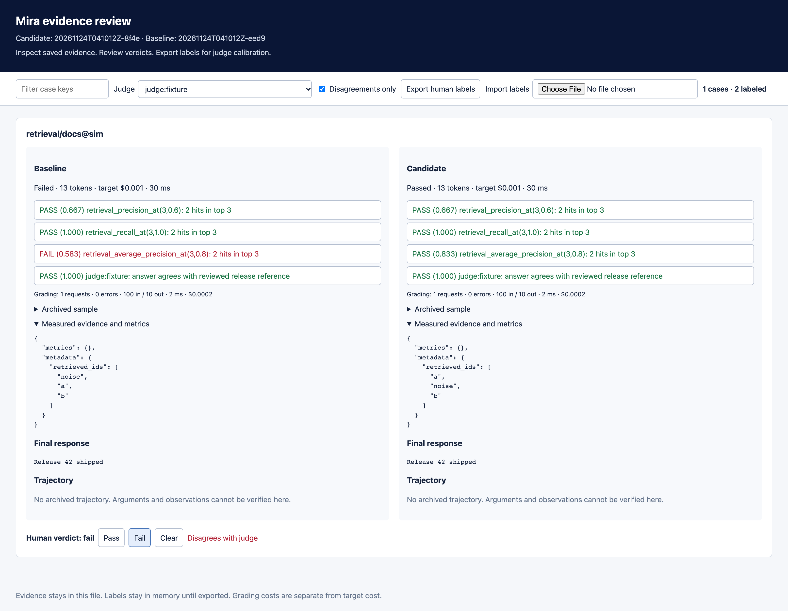

Mira adds diagnostic scorers for correlated tool arguments and observations,
ordered tool steps, and ranked retrieval results across Rust, Python, and
TypeScript. Saved runs can now be checked against absolute acceptance policies
and a declared scenario-by-quality coverage inventory.

```bash
mira assess RUN --policy policy.toml --out assessment.json
mira review CANDIDATE --baseline BASELINE --out review.html
```



The offline HTML reviewer shows trajectories side by side and exports human
labels tied to captured executions. Judge requests, errors, tokens, latency,
and explicitly priced cost estimates are recorded separately from target usage,
including malformed verdicts. Spend thresholds are post-run acceptance gates.

See [Diagnostics and acceptance](https://github.com/everruns/mira/blob/main/docs/diagnostics.md)
for the policy format, scorer contracts, grounding and conversation-retention
judge recipes, and a runnable offline workflow.
