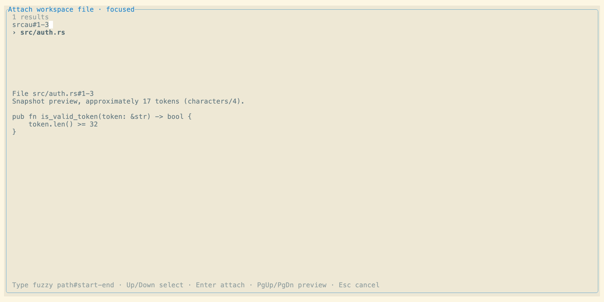

Inspect actual check results and whether their workspace evidence is still
current. Follow background logs, search output, cancel work, or message an agent
without leaving the terminal conversation.

```text
/checks
/tasks
/context
/files
/btw What changed so far?
```



The context explorer distinguishes active instructions, available and loaded
skills, filtered history, and unsent attachments. The attention inbox tracks
unread outcomes and offers optional alerts when terminal focus is elsewhere.
Pin, rename, archive, or group sessions; inspect and revoke session grants;
and review the actual restoration diff before rewinding files.

Dialogs keep body text and answer controls visible in short terminals. Keyboard
and mouse input follow the visible dialog, long descriptions scroll, and panels
restore their reading position. See [Terminal workflows](https://github.com/everruns/yolop/blob/main/docs/features/terminal-workflows.md).
