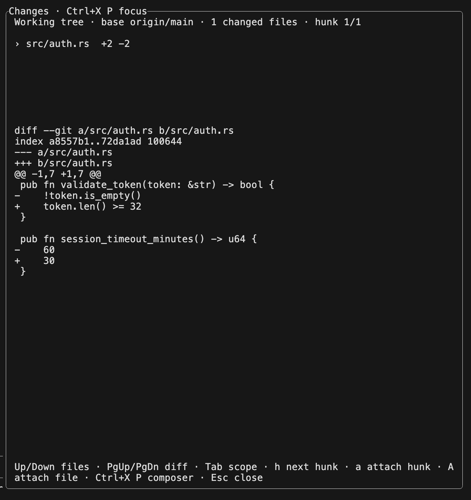

Review changed files without leaving the conversation, preview a checkpoint
before restoring it, and find earlier sessions by title, repository, branch,
or recorded messages. Session drafts and attachments are restored when you return.



```text
/diff
/attach src/main.rs#20-45
/timeline
```

Press **Ctrl+P** for searchable actions. The changes panel refreshes while you
work; attach a file diff or hunk to your next question. Inspect prompt context
with `/attachments`, edit longer prompts through **Ctrl+G**, and use `/recover`
after a failed turn. Approval prompts explain one-time and session-wide scope,
and `/context` separates context occupancy from cumulative usage.

See [Terminal workflows](https://github.com/everruns/yolop/blob/main/docs/features/terminal-workflows.md).
