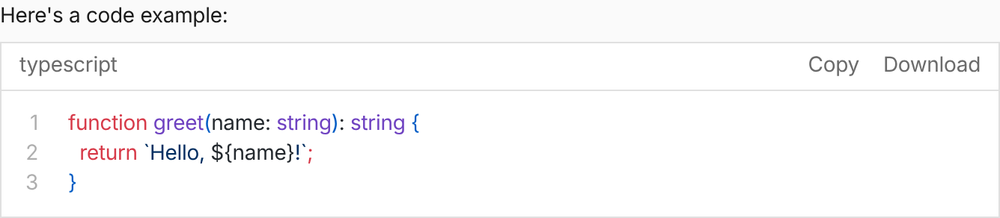

Agent replies, descriptions, prompts and Markdown file previews now render with Words, a
streaming Markdown renderer written in WebAssembly. A 30 KB reply with 19 code blocks
streams with about 3.5x less CPU (0.5 ms per token batch instead of 1.8 ms), holds 3 MB of
memory instead of 24 MB, and a session with 30 such replies reopens in 0.6 s instead of
1.8 s. On a slow phone, streaming no longer takes half of every frame.

Nothing changes in what you write: tables, GitHub alerts, citations, link icons,
highlighted code and [Markdown diagrams](/features/markdown-diagrams/) all render as before,
and diagrams now follow the dark theme.

