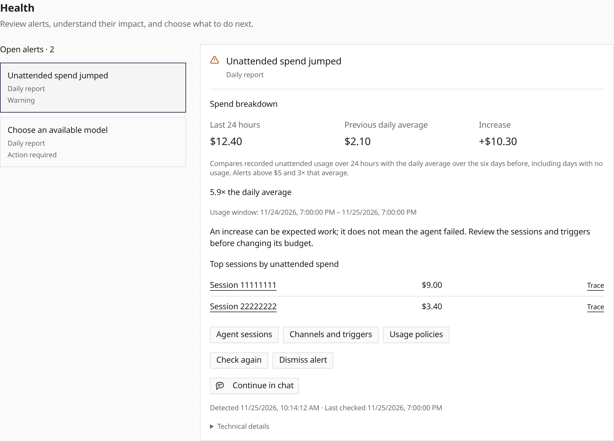

Health now shows alerts beside their details, with a selected row and a back
link on smaller screens. Single-page lists hide pagination controls.

**Unattended spend jumped** is a warning. Review its 24-hour total, preceding
six-day daily average and largest contributing sessions, with links to cost,
trace, agent sessions and triggers. [Costs and usage policies](/features/costs/)
explain the charges.

Use **Dismiss alert** with a reason for expected work. The same spike stays
acknowledged until spending recovers; a later spike opens a new alert. Budgets
and schedules stay unchanged.

Choose **Continue in chat** to [investigate the issue in Platform Chat](/features/ui/#investigate-an-issue-in-chat).
It opens an editable draft with context and preserves unsent text. Press Send
when ready.

