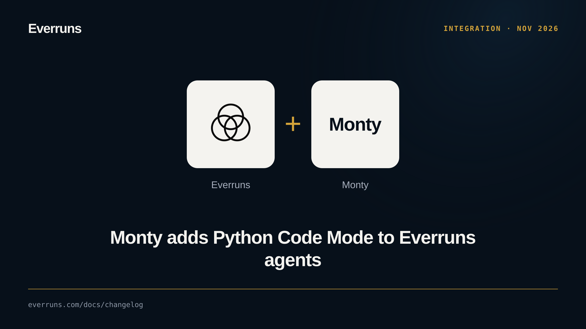

Agents can now use Monty as an optional Python execution interface on Framework,
Server workers and agentd executors. Programs call authorized tools and save
their continuation when approval pauses execution. A private effect journal
replays recorded outcomes and refuses to repeat an operation with an unknown
result.

```rust
// Cargo: everruns features monty, openai.
use everruns::{Agent, OpenAI, PythonCodeMode};

# fn build() -> Result<(), Box<dyn std::error::Error>> {
let agent = Agent::builder()
    .provider(OpenAI::from_env()?)
    .model("gpt-6.2-sol")
    .capability(PythonCodeMode)
    .build()?;
# let _ = agent;
# Ok(())
# }
```

Provision the pinned worker, Linux isolation and private storage described in
[Python Code Mode](/framework/python-code-mode/). Bashkit's existing Python
runtime is unchanged; compare [execution options](/framework/execution-options/)
to decide whether a direct Python interface and saved continuations fit your
agent.

The shared Code Mode and MCP-scale eval studies include a Monty comparison arm,
with effect-based approval/resume scoring and separate hosted boundary checks.
