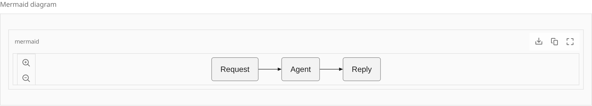
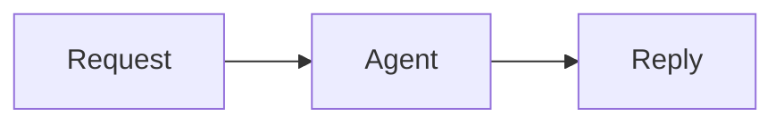

Mermaid code blocks in chats, agent descriptions, prompts, and Markdown file previews now render with Pele. Diagrams have zoom controls, follow the light or dark theme, and adapt to their available space. See [Markdown diagrams](/features/markdown-diagrams/) for where to use them.



For example, add this block to an agent reply or a Markdown file:

````markdown

````
