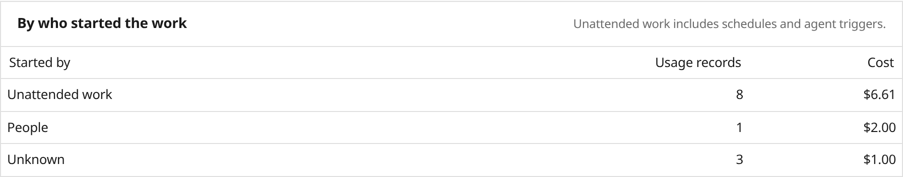

Platform Chat can inspect a session's follow-up schedules and investigate
[agent trigger](/features/agent-triggers/) runs through the existing platform
commands. Trigger history supports time windows and pagination, and records the
authenticated manual requester and resulting input message when available.

Health issues preserve the evidence that opened each new episode. Rechecking an
issue updates its current evidence while retaining the original observation.
Cost summaries support combined agent, session, source and starter filters with
joint breakdowns, and session costs accept explicit time windows. Reads also work
for sessions running on the data plane. Historical evidence that was never
recorded remains unknown; platform cost estimates do not establish an external
provider bill.

For example, compare sources and starters within each agent session:

```bash
everruns costs summary get --group-by agent,session,source,started_by
```

Costs keep unrecorded starters separate from people:


