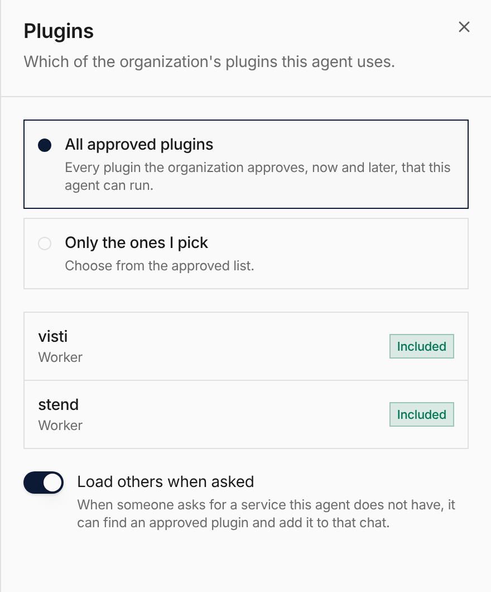

Plugins are no longer an experiment. An admin approves them once in
**Settings > Organization > Plugins**, and an agent's new **Plugins** setting
takes *All approved* or a pick. A plugin approved next week joins every "all"
agent without anyone editing it. Turn on *Load others when asked* and a person
can say "set up Visti" mid-conversation.



Work Chat users get a **Customizations** page. Each channel decides whether
they may add approved plugins or turn off one the agent includes:

```json
{
  "plugins": {
    "allow_adding": true,
    "allow_turning_off": false
  }
}
```

A plugin that needs a shell or sandbox the agent lacks is skipped instead of
failing the turn. See [Plugins](/capabilities/plugins/).
