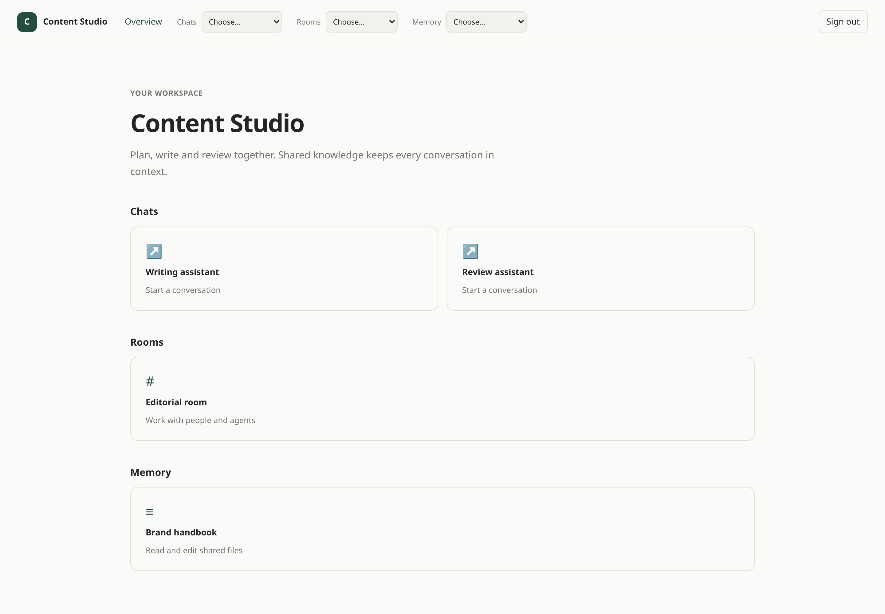
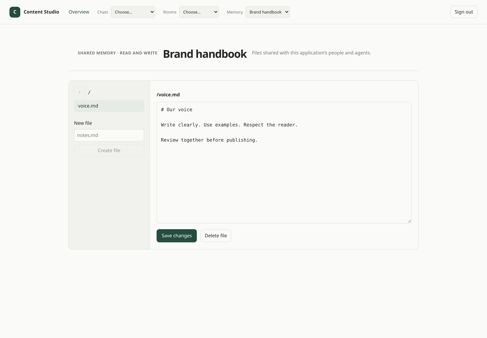

[Applications](/features/applications/) bring multiple Work Chats, Rooms and shared
Memory into one published workspace. In **Build → Applications**, create resources
or attach existing ones, choose their navigation labels, configure the audience,
and publish at a permanent name. An optional launcher appears in the Everruns sidebar.

External audiences receive an Application-specific identity. Organization audiences
reuse existing member accounts. Chats keep private conversations; Rooms and Memory
share only what the author explicitly includes. Memory write access is opt-in.

Self-hosted installations can enable the browser host with the new
`everruns k8s up --applications-domain` options. See the
[Kubernetes setup guide](/sre/runbooks/applications/) for identity, DNS, TLS and
restricted database credentials. Automations remain reserved for the future runtime.
