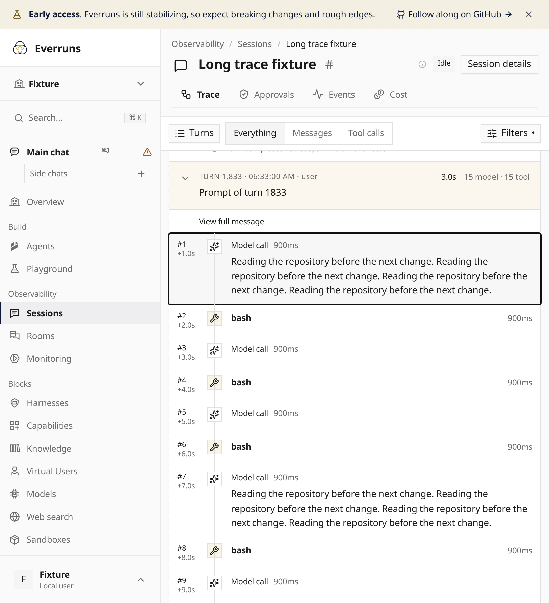

Chat wraps long messages, task names and automatic reports within phone,
floating and docked panels. Code blocks keep their own horizontal scrolling.

Trace now follows its pane's width when Chat is open beside it. Narrow panes
keep the timeline visible: **Turns** opens navigation, **Filters** reveals
secondary controls, and selecting a step opens a full-height detail drawer.
Return with **Back to trace** or Escape without losing your place. Wider panes
show details and turn navigation alongside the timeline.

Session metadata and actions remain available under **Session details** in
narrow panes. [The UI guide](/features/ui/) describes session inspection.

