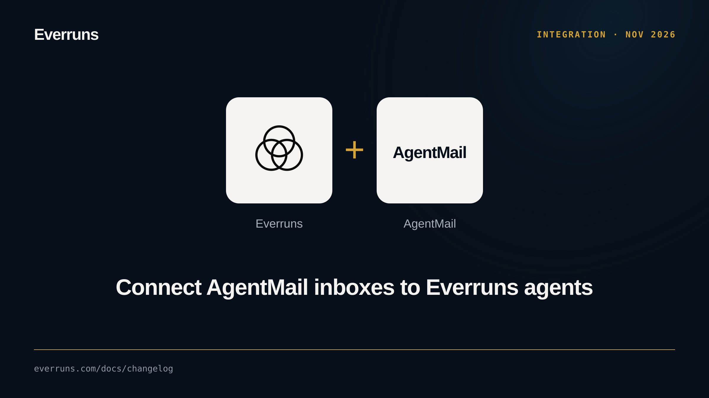
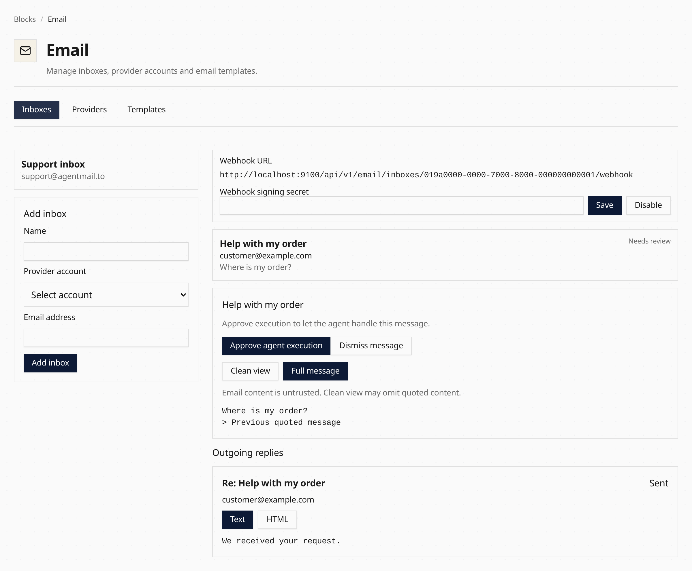
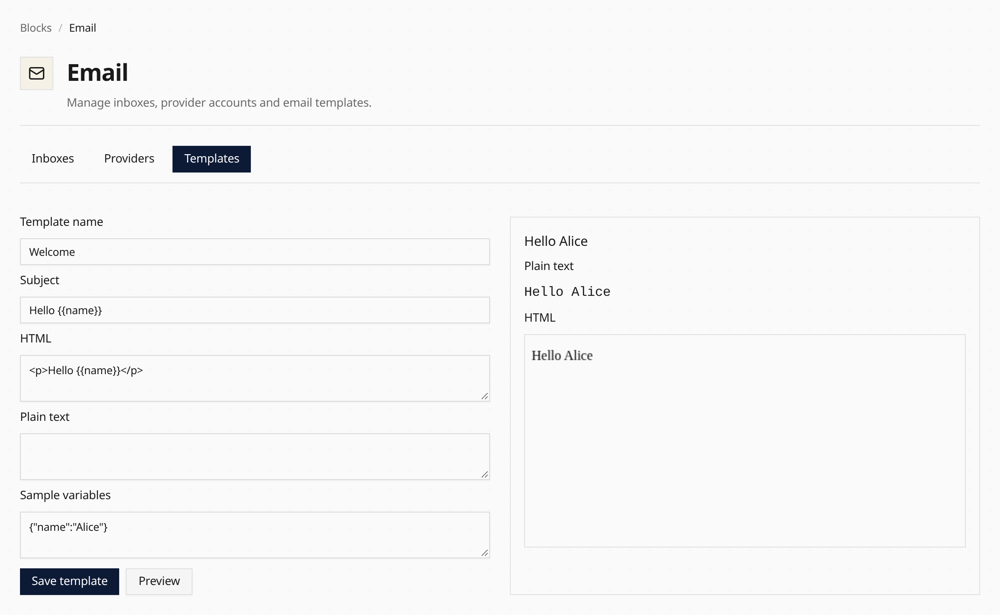

Agents can now receive and reply to email through AgentMail on the self-hosted
Platform's v2 data plane. Open **Email → Providers** to save an account, register
an inbox, then publish an Email channel on an agent. The same agent can have a
Slack channel while keeping each conversation's audience and history separate.

Incoming mail enters a durable backlog. Review subjects and previews before
opening clean or full messages. Execution and sending require separate approvals
by default. Plus addresses share the registered inbox, and templates derive
matching text and HTML alternatives.

See [Email inboxes](/features/email/) for setup, automatic processing and the
scoped tool restrictions. The examples below show message review and template
preview with sample data.

