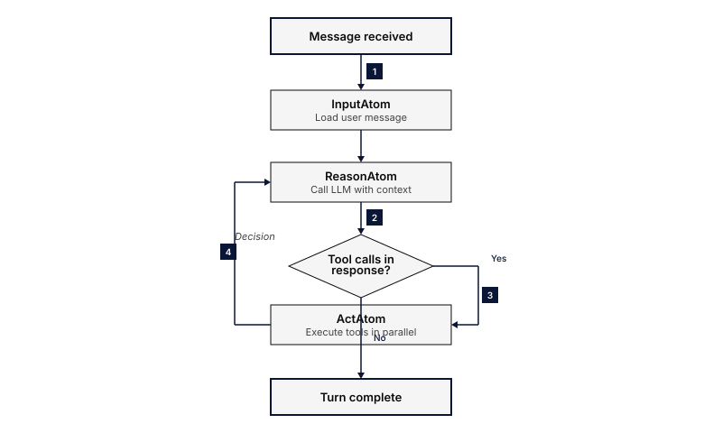

An "agent" is a loop, not a function call. This page explains the loop Everruns runs and why it's shaped the way it is.

## Reason, then act



Each **turn** runs a bounded cycle:

1. **Reason.** Build the model context from the system prompt, conversation history and tool results, applying context limits and compaction when needed, then call the LLM. The model either produces text or requests tool calls.
2. **Act.** If the model requested tool calls, execute them in parallel. The results become new messages in the conversation.
3. **Loop.** If there were tool calls, go back to step 1. A response without tool calls can finish the turn, unless pending input or a configured completion check continues it.

A turn is capped at **500 iterations** by default. That cap exists for one reason: a misbehaving prompt can drive the model into an infinite tool-calling spiral, and an unbounded loop costs real money in tokens. The cap is `max_iterations`, set on the agent and overridable per session (session overrides agent, agent overrides the default).

## Why parallel act?

The model often emits several tool calls in one response, "read these three files" or "fetch these two URLs". Executing them sequentially would serialize independent work for no reason. Everruns runs all tool calls from a single reason step concurrently and only re-enters reason once every call has completed (or failed).

This means tool implementations cannot assume ordering between calls within a single act phase. If two tools must run in order, the model has to emit them across two reason steps (iterations).

## Execution phases

When an assistant message includes tool calls, the model hasn't given a final answer yet, it's just narrating its plan. A message without tool calls is a candidate final answer; pending steering or a completion check can still continue the turn.

Everruns labels each assistant message with an **execution phase**: `Commentary` (intermediate, before/between tool calls) or `FinalAnswer` (completed response). Two consumers care:

- **The model.** Some providers (OpenAI Responses API on the GPT-5.4 and GPT-5.5 families) accept and return phase annotations on replayed history. Without them, models can mistake earlier commentary for completed answers and stop early on long flows.
- **The UI.** Phase tells the chat surface whether to keep the "thinking" indicator on or render the message as a final response.

Phases are derived from message state (presence of tool calls) and stored on the message. Providers that don't accept phases on the wire still get accurate internal tracking.

## Turn lifecycle

A normal turn follows this lifecycle (waiting, budget and recovery events can appear between these steps):

```
turn.started
  reason.started → reason.completed (one LLM call)
  act.started    → act.completed   (zero or more tool calls)
  ... (repeat reason/act until the model produces a final answer or max iterations) ...
turn.completed | turn.failed | turn.cancelled | turn.sealed
```

Streaming text and tool calls produce `output.message.delta` and `tool.started` / `tool.completed` events in between. The full event catalog is in the [Event Reference](/event-reference/).

## How the Platform resumes a turn

The Platform runs each session as a **leased actor**, not as a queue of separate reason and tool tasks. Sending a message stores it and marks its session runnable in one PostgreSQL transaction. A worker leases the session and drives the whole reason–act loop, recording the outcomes needed for recovery in its event log.

If the worker dies, its lease expires and another worker folds the recorded turn history to continue. Recorded model responses and tool results are reused. An unfinished tool call is retried only when its declared side-effect class permits it or it never started; otherwise its outcome is recorded as interrupted and unknown. Recovery does not make an external side effect exactly-once.

Lease fencing rejects writes from a displaced holder. It cannot undo an external request already in flight. A turn waiting for a human approval, question answer or client-side tool releases its worker until a result makes the session runnable again.

The embeddable Framework shares the execution loop, but durability depends on its hosting profile: an in-memory Engine does not survive process exit. See [Durable execution](/explanation/durable-execution/) and [Framework Architecture](/framework/architecture/) for the recovery boundaries.

## What happens when the loop "gets stuck"

Four failure modes show up in practice:

- **Runaway tool calls.** The model keeps calling tools without converging. Mitigated by the iteration cap. Once the cap is reached the engine stops scheduling tool calls and the turn ends with `turn.completed` (the `iterations` field shows the count), not `turn.failed`.
- **A tool that hangs.** Tool calls have configurable timeouts. The act phase reports the failure as a tool result so the model can recover on the next reason step.
- **The provider stream breaks.** A dropped connection, a stall or a provider server error is retried with backoff, also after the model has streamed part of its answer, as long as it has not called a tool. The retry emits `output.message.started` again for the same message and streams the answer from the beginning, so render `accumulated` rather than the sum of deltas.
- **The model rejects the prompt as too large.** Context [compaction](/advanced/compaction/) runs reactively and the request is retried. The conversation continues with older messages compressed.

In all four cases the session stays usable. You don't lose the conversation; you lose at most one turn.
