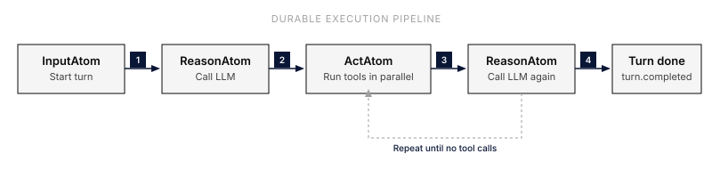

The word "durable" in "durable agentic harness engine" means a specific thing: **every step of an agent's execution survives a process restart**. This page explains why that matters, how it works, and what it costs.

## The problem

An agent turn looks simple from the outside, send a message, get a streamed response. Internally it's a chain of network calls that each take seconds:

1. Call the LLM provider.
2. Parse tool calls, dispatch them.
3. Wait for each tool to return.
4. Call the LLM again with the results.
5. ...repeat...

Anywhere in that chain, the worker process can crash, the container can be reaped, the network can blip. A naïve implementation loses all the work done so far and forces the user to retry. For a 30-second turn that already burned tokens, this is unacceptable.

## The mechanism

Everruns treats each session as an **actor** whose state is its event log. Every message, model response, tool call and tool result is appended to the session's log in PostgreSQL before anything acts on it. A turn is never held anywhere else: the log is enough to pick it up again.

- Sending a message stores it and marks the session runnable, in one transaction.
- A worker leases the runnable session and runs the whole turn: reason, act, reason again, until the model answers or the turn waits on a person.
- The worker renews its lease every few seconds while the turn runs, and gives it back when the turn ends.

Messages that arrive while a turn runs reach that turn before its next model call. A message that arrives just as the turn ends starts the next turn. A turn waiting on a person (a client-side tool, an approval, a question) holds no worker: the answer is recorded in the log and the session becomes runnable again.

When a worker crashes mid-turn, its lease stops being renewed and expires after about ten seconds. Another worker leases the session, reads the turn's part of the log and continues the turn where it stopped. The application sees a momentary stall in the SSE stream, then it continues.

A worker that stalls instead of crashing cannot interfere: each lease has a fence number, and a worker whose lease was taken over stops the turn without writing anything more.

## Why a custom engine

The obvious alternative is Temporal (or Cadence, or Restate). Everruns deliberately built its own minimal durable execution instead: session leases and the event log for turns, and `everruns-durable`, a generic, published Rust crate (task queue, event log, signals, schedules, retries, dead letter queue, circuit breakers) with no agent concepts, for the background work around them. The reasoning:

1. **Single dependency.** PostgreSQL is the only required stateful infrastructure (Valkey and NATS are optional). Operators don't need to run a second cluster with its own ops story.
2. **Co-located with the rest of the platform.** Workflow events and session events live in the same database, in the same transaction when needed. There's no eventual consistency between "what happened" and "what was reported."
3. **Tight scope.** Everruns runs agentic workflows specifically, limited fan-out, short-to-medium duration, well-understood failure modes. We don't need the full Temporal feature set, and the operational surface area of a tightly-scoped engine is much smaller.

The trade-off: no multi-region replication beyond what PostgreSQL itself offers, no language-agnostic SDK (the engine is a Rust library), no visual workflow designer. For agent execution these are not missed.

## Guarantees

What durable execution gives you:

- **No work lost on crash.** If a worker dies, another worker resumes the turn from its log. A model response already recorded is not requested again, and an answer already recorded is not given twice.
- **Persisted tool results.** Tool calls are persisted by their result, not their attempt, so a tool whose result was recorded is not re-run. A call cut off before its result was recorded runs again only when its tool declares that safe (read-only or idempotent); otherwise it is recorded as interrupted and the model is told its outcome is unknown.
- **One worker per session.** A session's lease keeps two workers from ever running its turn at once.
- **Authoritative history.** Reloading a session reads back the same persisted message sequence, which makes traces and exports authoritative.

What it doesn't give you:

- **Idempotence of side effects.** A tool that declares itself idempotent is run again after a crash, so if it POSTs to an external API it must make the repeat harmless, for example with its own idempotency key. A tool that declares nothing is never run twice, but a crash after it acted and before its result was recorded leaves its outcome unknown.
- **Real-time latency guarantees.** Persisting every event adds a few milliseconds per write. For agent workloads (already dominated by LLM latency) this is invisible; for hot-loop workloads it would be costly.

## Durability in the Framework

Rust applications that embed the [Framework](/framework/) get durability the
same way: from the session's event log. With `LocalConfig` the log
outlives the process, and a turn a restart cut off continues from it: calls
that are safe to repeat run again, the rest are recorded as interrupted. Each
session runs as an actor that holds its lease while a turn runs, so processes
that share a data directory never run one session at once. See [Framework
Architecture](/framework/architecture/).

## When the database becomes the bottleneck

Everruns is designed to run on a single PostgreSQL primary. Read replicas help for reporting; write-heavy session loads are kept manageable by keeping event payloads compact.

In practice, LLM provider rate limits tend to cap throughput long before the database does.

## Further reading

- [The agentic loop](/explanation/agentic-loop/), what each step inside a turn looks like.
- [Architecture](/explanation/architecture/), how the control plane and workers interact.
